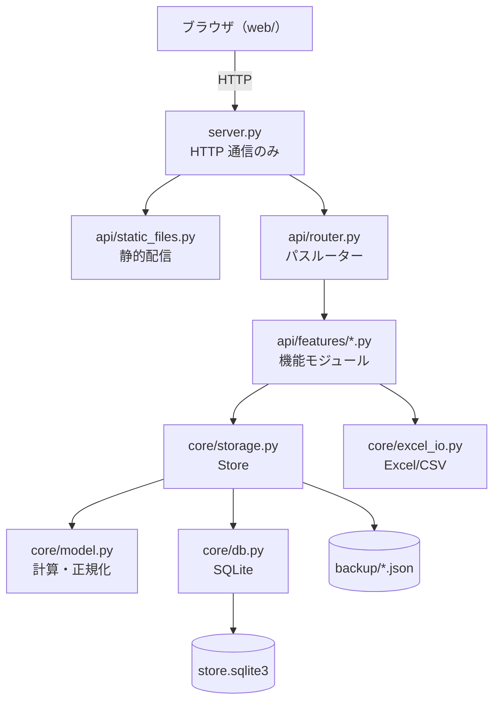

# 第2開発管理ツール 仕様書

最終更新: 2026-09-08

---

## 1. システム概要

### 1.1 目的

開発プログラム（製造・詳細設計）の実績を一元管理し、規模・工数・品質の指標を自動算出する。
あわせて、担当者が日々の業務予定と実績を日次で記録し、チームの稼働状況を可視化する。

### 1.2 構成する2つのアプリケーション

| キー | 名称 | 用途 |
| --- | --- | --- |
| `dev` | 開発プログラム管理 | タスク単位の規模・工数・品質・スケジュール管理 |
| `plan` | 業務予定管理 | 担当者単位の日次予定／実績報告 |

画面左上のタブで切り替える。設定画面は両アプリで共有する。

### 1.3 動作環境

| 項目 | 要件 |
| --- | --- |
| サーバー | Python 3.10 以降。標準ライブラリのみで動作 |
| 追加ライブラリ | `openpyxl`（Excel 入出力を使う場合のみ。無くても他機能は動作） |
| クライアント | Chromium 系 / Firefox / Edge の最新版。ビルド・npm 不要 |
| コンテナ | `python:3.12-slim`、非 root（uid 10001）で実行 |

### 1.4 設計方針

- **機能の独立化** — API のエンドポイントは機能ごとに独立したモジュールへ分割し、自動登録する
- **層の分離** — HTTP 通信（`server.py`）／API（`api/`）／ドメイン・永続化（`core/`）を分ける
- **依存の最小化** — Web フレームワークを使わず標準ライブラリで実装する
- **エンコーディング安全** — Python ソースは ASCII を保ち、日本語ラベルは JSON 定義ファイルに置く

---

## 2. アーキテクチャ

### 2.1 レイヤ構成



### 2.2 各モジュールの責務

| ファイル | 責務 |
| --- | --- |
| `tool/server.py` | HTTP の受信・応答、Host ヘッダ検証、閲覧専用モード判定、静的配信への振り分け、ログ出力、起動処理 |
| `tool/api/router.py` | `{name}` プレースホルダ対応のパスルーティング。リテラル一致を優先 |
| `tool/api/http.py` | `Request` / `Response` / `ApiError` と JSON・添付ファイル応答ヘルパ |
| `tool/api/static_files.py` | `web/` 配下の静的ファイル配信。ディレクトリトラバーサル遮断 |
| `tool/api/features/*.py` | 各機能のエンドポイント定義 |
| `tool/core/config.py` | 環境変数・CLI 引数による設定 |
| `tool/core/db.py` | SQLite スキーマ、読み書き、列追加マイグレーション |
| `tool/core/storage.py` | 業務ロジック（追加・更新・削除・取込マージ・マスタ同期）とバックアップ |
| `tool/core/model.py` | スキーマ読込、値の正規化、派生指標の計算 |
| `tool/core/excel_io.py` | Excel／CSV の読み書き |

### 2.3 リクエスト処理フロー

1. `Handler._dispatch()` が Host ヘッダを検証（`DPM_ALLOWED_HOSTS` が空なら無条件許可）
2. `/api/` 以外は `static_files.serve()` へ。GET / HEAD 以外は 404
3. 閲覧専用モードで GET / HEAD 以外なら 403 `read-only-mode`
4. `ROUTER.resolve(method, path)` でハンドラを解決
   - 未一致かつ同一パスに他メソッドが存在 → 405 `method-not-allowed`
   - 完全に未一致 → 404 `not-found`
5. ボディを読み込み（`DPM_MAX_BODY` 超過は 413）、`Request` を組み立ててハンドラを実行
6. 例外は `ApiError` → 指定ステータス、`JSONDecodeError` → 400、その他 → 500（詳細はログのみ、クライアントには `internal-error`）

### 2.4 機能モジュールの登録

`api/features/__init__.py` が `pkgutil` でパッケージ内のモジュールを列挙し、
`router` 属性を公開しているものを `api.build_router()` が統合する。
ファイルを追加・削除するだけで機能を増減できる。

```python
# tool/api/features/example.py
from ..http import Request, Response, json_response
from ..router import Router

router = Router()

@router.get("/api/example")
def example(_req: Request) -> Response:
    return json_response({"ok": True})
```

現在の登録数は 26 エンドポイント（`python server.py --routes` で確認可能）。

---

## 3. データモデル

### 3.1 論理構造

| データ | 内容 |
| --- | --- |
| `tasks` | 開発プログラムのタスク。種別 `mfg`（製造）／`dd`（詳細設計） |
| `plans` | 業務予定・実績。種別 `plan`（始業前）／`result`（終業前） |
| `entries` | 担当者 × 月の実績入力状況 |
| `masters` | 選択肢マスタと計算パラメータ |
| `savedViews` | 一覧画面のユーザー定義ビュー |
| `users` | ログインユーザー（ID・氏名・担当者名・権限・パスワードハッシュ） |
| `meta` | スキーマバージョン、最終更新日時、セッション署名鍵（`authSecret`） |

### 3.2 SQLite スキーマ

```sql
CREATE TABLE meta        (key TEXT PRIMARY KEY, value TEXT);
CREATE TABLE masters     (key TEXT PRIMARY KEY, value TEXT NOT NULL);   -- value は JSON
CREATE TABLE tasks (
    id TEXT PRIMARY KEY, seq INTEGER NOT NULL, type TEXT,
    program_id TEXT, project TEXT, assignee1 TEXT, assignee2 TEXT,
    start_date TEXT, end_date TEXT, created_at TEXT, updated_at TEXT,
    payload TEXT NOT NULL);                                             -- payload は JSON
CREATE TABLE plans (
    id TEXT PRIMARY KEY, seq INTEGER NOT NULL, kind TEXT,
    member TEXT, project TEXT, date TEXT, end_date TEXT,
    created_at TEXT, updated_at TEXT, payload TEXT NOT NULL);
CREATE TABLE entries     (member TEXT, month TEXT, value TEXT, PRIMARY KEY (member, month));
CREATE TABLE saved_views (seq INTEGER PRIMARY KEY, value TEXT NOT NULL);
CREATE TABLE users (
    id TEXT PRIMARY KEY, seq INTEGER NOT NULL, name TEXT, member TEXT,
    role TEXT NOT NULL, password TEXT NOT NULL,                         -- role: owner / admin / user
    created_at TEXT, updated_at TEXT);
```

`users` は JSON 出力・JSON 復元・バックアップの対象外（復元でアカウントが消えないようにするため）。

インデックス: `tasks(seq, type, project)` / `plans(seq, date, member)`

検索・集計に使う項目は実カラムに展開し、スキーマ駆動で増減する項目は `payload`（JSON）に格納する
ハイブリッド構成。`fields.json` を変更しても DB マイグレーションは不要。

### 3.3 タスクの項目定義（`tool/core/fields.json`）

全 44 項目。`types` 列は対象種別（mfg = 製造、dd = 詳細設計）。

#### 基本情報

| キー | ラベル | 型 | 対象 | 選択肢 |
| --- | --- | --- | --- | --- |
| `type` | 種別 | select | mfg, dd | 製造 / 詳細設計 |
| `system` | システム | select | mfg | `systems` マスタ |
| `resource` | リソース区分 | select | mfg, dd | `resources` マスタ |
| `designType` | 設計種別 | select | dd | `designTypes` マスタ |
| `programId` | プログラムID | text | mfg, dd | — |
| `kubun` | 区分 | select | mfg, dd | `kubuns` マスタ |
| `project` | 案件名 | select-free | mfg, dd | `projects` マスタ（自由入力可） |

#### 規模

| キー | ラベル | 型 | 対象 |
| --- | --- | --- | --- |
| `baseStep` | 母体step | number | mfg |
| `newStep` | 新規step | number | mfg |
| `modStep` | 修正step | number | mfg |
| `pages` | 設計書頁数 | number | dd |

#### スケジュール

| キー | ラベル | 型 | 対象 |
| --- | --- | --- | --- |
| `startDate` | 開始日 | date | mfg, dd |
| `endDate` | 終了日 | date | mfg, dd |
| `assignee1` | 担当者① | select-free | mfg, dd |
| `assignee2` | 担当者② | select-free | mfg, dd |
| `status` | ステータス | select | mfg, dd |
| `progress` | 進捗率(%) | number | mfg, dd |

#### 工数

| キー | ラベル | 型 | 対象 |
| --- | --- | --- | --- |
| `hourMake` | 工数 製造(h) | number | mfg |
| `hourCheck` | 工数 チェックリスト(h) | number | mfg |
| `hourVerify` | 工数 検証資料(h) | number | mfg |
| `hourDesign` | 詳細設計 時間(h) | number | dd |

#### 品質

| キー | ラベル | 型 | 対象 |
| --- | --- | --- | --- |
| `issueCode` | 指摘(コーディング) | number | mfg |
| `issueCheck` | 指摘(チェックリスト) | number | mfg |
| `issueVerify` | 指摘(検証資料) | number | mfg |
| `defect` | 障害発生件数 | number | mfg |
| `issues` | 指摘件数 | number | dd |

#### その他

| キー | ラベル | 型 | 対象 |
| --- | --- | --- | --- |
| `editor` | 使用エディタ | select-free | mfg |
| `compileCount` | コンパイル回数 | number | mfg |
| `compileMain` | コンパイル内訳 MAIN | number | mfg |
| `month` | 計上月 | text | dd |
| `tags` | タグ | text | mfg, dd |
| `note` | 備考 | textarea | mfg, dd |

#### 自動計算項目（入力不可）

| キー | ラベル | 対象 |
| --- | --- | --- |
| `convStep` | 換算step | mfg |
| `totalHour` | 総工数(h) | mfg, dd |
| `testRatio` | テスト比率(%) | mfg |
| `prodNew` | 生産性 新規(step/h) | mfg |
| `prodMod` | 生産性 修正(step/h) | mfg |
| `prodMonth` | 月換算生産性 | mfg |
| `issueTotal` | 指摘合計 | mfg, dd |
| `quality` | 品質(指摘/KS) | mfg |
| `defectRate` | 障害(件/KS) | mfg |
| `pagePerHour` | 設計効率(頁/h) | dd |
| `issuePerPage` | 品質(指摘/頁) | dd |
| `durationDays` | 期間(日) | mfg, dd |

システム項目: `id`（12桁hex）、`createdAt`、`updatedAt`、`effectiveStatus`、`isLate`

### 3.4 業務予定・実績（plans）

| キー | 型 | 説明 |
| --- | --- | --- |
| `id` | text | 12桁hex |
| `kind` | text | `plan` = 始業前の予定 / `result` = 終業前の実績 / `assignment` = 取組み予定（期間）。未指定は `plan` |
| `member` | text | 担当者（氏名エイリアスで正規化） |
| `date` / `endDate` | date | 対象日。日次入力では両方同じ日付、`assignment` では開始日〜終了日 |
| `category` | text | **工程（作業区分）**。`planCategories` マスタ |
| `project` | text | 案件名 |
| `programId` / `taskId` | text | 開発タスクとの紐付け |
| `title` | text | 作業内容 |
| `hours` | number | 予定工数(h)。`plan` はその日、`assignment` は期間全体の合計 |
| `actualHours` | number | 実績工数(h)。主に `result` で使用 |
| `progress` | number | 進捗率(%)。0〜100 にクランプ |
| `status` | text | `planStatuses` マスタ（予定 / 実施中 / 完了 / 中止） |
| `assignmentId` | text | **紐づく取組み予定の ID**（`plan` / `result` から参照。任意） |
| `sourceId` | text | 実績と同じ行（日次入力の予実一体シート）の予定 ID。予定外の実績は空 |
| `note` | text | 備考 |
| `allDay` | bool | 終日フラグ（既定 true） |
| `updatedBy` | text | ログイン中ユーザーの担当者名（未設定なら氏名）から記録される更新者 |
| `createdAt` / `updatedAt` | text | ISO 8601（ローカルタイムゾーン付き） |

#### 取組み予定（assignment）と日次入力の関係

```
assignment  「9/7〜9/18 SDLP341 製造（予定 40h）」
   │
   ├─ plan   9/8  予定 6h      ← assignmentId で参照
   ├─ result 9/8  実績 5.5h 進捗 70%
   └─ result 9/9  実績 7h   進捗 90%
```

ロールアップはクライアント側（`State.assignmentRollup`）で算出し、DB には保存しない。

| 項目 | 算出方法 |
| --- | --- |
| 実績積上 | 紐づく `result` の `actualHours` 合計 |
| 消化率 | 実績積上 ÷ `assignment.hours` × 100 |
| 進捗率 | 紐づく `result` のうち**最新日付の進捗率**（同一日なら `updatedAt` が新しい方） |

取組み予定を削除すると、紐づいていた日次行は残したまま `assignmentId` のみ解除される。
取組み予定は日次の集計（ダッシュボード「本日の業務予定」・予定サマリの工数）には含めない。

### 3.5 マスタ（`tool/core/masters.json`）

| キー | 内容 |
| --- | --- |
| `systems` | システム名 |
| `resources` | リソース区分（JN / リアル / バッチ / 画面 …） |
| `resourceGroups` | リソース区分の分類（サブルーチン系・リアル系 など） |
| `kubuns` | 新規 / 修正 / 削除 / 調査 |
| `statuses` | タスクのステータス（値＋色） |
| `designTypes` | プログラム設計 / 詳細設計 |
| `editors` | 使用エディタ |
| `members` | 担当者（データから自動追加） |
| `excludedMembers` | 担当者から除外した名前。設定画面で `members` から削除した名前と特権管理者の担当者名が入り、データからの自動追加・画面の担当者一覧の対象外になる（タスク・予定のデータ自体は残る） |
| `projects` | 案件（データから自動追加・ソート） |
| `entryStatuses` | 完了 / 対象外 / 未入力 |
| `planCategories` | **工程（作業区分）**。値＋色。製造 / 詳細設計 / 基本設計 / テスト / レビュー / 調査・解析 / 会議 / 資料作成 / 教育・研修 / 問合せ対応 / 休暇 / その他 |
| `planStatuses` | 予定 / 実施中 / 完了 / 中止（値＋色） |
| `settings` | 計算パラメータ（下記） |

#### 計算パラメータ（`masters.settings`）

| キー | 既定値 | 用途 |
| --- | --- | --- |
| `baseCoef` | 0.06 | 換算step の母体係数 |
| `newCoef` | 1 | 換算step の新規係数 |
| `modCoef` | 2 | 換算step の修正係数 |
| `monthHours` | 150 | 月換算生産性の基準時間 |
| `fiscalStartMonth` | 4 | 年度開始月 |
| `workHoursPerDay` | 7.5 | 1人日あたり時間 |
| `targetProdMonth` | 800 | 目標 月換算生産性 |
| `targetQuality` | 50 | 目標 品質（指摘/KS の上限） |
| `sourceExcel` | 開発プログラム一覧_R7.xlsx | 既定の取込ファイル名 |

### 3.6 列挙値（`tool/core/enums.json`）

| キー | 値 |
| --- | --- |
| `status` | todo=未着手 / doing=進行中 / review=レビュー中 / done=完了 / hold=保留 / na=対象外 |
| `kubun` | new=新規 / mod=修正 |
| `entry` | done=完了 / na=対象外 / todo=未入力 |
| `sample` | 取込時に除外する行の接頭辞（「例）」「例」「sample」） |
| `memberAlias` | 表記ゆれの吸収（例: `伊藤（ま）` → `伊藤(ま)`、`𠮷田` → `吉田`） |

---

## 4. 計算仕様

すべて `core/model.py` の `compute()` で算出する。タスクの保存時、および
`GET /api/tasks` / `GET /api/bootstrap` の応答生成時に再計算される。

### 4.1 製造（mfg）

$$\text{換算step} = \begin{cases} \text{新規step} \times C_{new} & (\text{区分}=\text{新規}) \\ \text{母体} \times C_{base} + \text{修正step} \times C_{mod} & (\text{それ以外}) \end{cases}$$

$$\text{総工数} = \text{製造} + \text{チェックリスト} + \text{検証資料}$$

$$\text{テスト比率(\%)} = \frac{(\text{チェックリスト} + \text{検証資料}) \times 100}{\text{総工数}}$$

$$\text{生産性 新規} = \frac{\text{新規step}}{\text{製造工数}} \qquad \text{生産性 修正} = \frac{\text{修正step}}{\text{製造工数}}$$

$$\text{月換算生産性} = \frac{(\text{区分}=\text{新規 なら 新規step、それ以外は 修正step}) \times \text{monthHours}}{\text{総工数}}$$

換算step・月換算生産性は「開発プログラム一覧」Excel の数式（`IF(区分="新規", …)`）と同じく区分で式を切り替える。

$$\text{指摘合計} = \text{コーディング} + \text{チェックリスト} + \text{検証資料}$$

$$\text{品質(指摘/KS)} = \frac{\text{指摘合計} \times 1000}{\text{換算step}} \qquad \text{障害(件/KS)} = \frac{\text{障害件数} \times 1000}{\text{換算step}}$$

丸め: 換算step・総工数・生産性は小数2桁、テスト比率・月換算生産性は小数1桁、指摘合計は整数。

### 4.2 詳細設計（dd）

$$\text{総工数} = \text{詳細設計時間} \qquad \text{設計効率(頁/h)} = \frac{\text{頁数}}{\text{時間}} \qquad \text{品質(指摘/頁)} = \frac{\text{指摘件数}}{\text{頁数}}$$

製造専用の指標（換算step・テスト比率・生産性・品質・障害率）は `null` になる。

### 4.3 共通

- `durationDays` = 終了日 − 開始日 + 1（開始・終了が揃い、終了 ≧ 開始のときのみ）
- 分母が 0 または未入力の場合、結果は `null`（0 除算・NaN・Inf は出力しない）

### 4.4 実効ステータス（`effectiveStatus`）

`status` が明示されていればそれを採用。未設定の場合は日付から推定する。

| 条件 | 実効ステータス |
| --- | --- |
| 終了日 < 本日 | 完了 |
| 開始日 ≦ 本日 かつ（終了日なし または 終了日 ≧ 本日） | 進行中 |
| 開始日 > 本日 | 未着手 |
| 開始日なし・終了日なし | 未着手 |
| 開始日なし・終了日あり | 進行中 |

### 4.5 遅延判定（`isLate`）

実効ステータスが「完了」「対象外」以外で、かつ `終了日 < 本日` の場合に `true`。

### 4.6 値の正規化

| 対象 | 処理 |
| --- | --- |
| 数値 | NFKC 正規化 → カンマ・`%` 除去 → float。変換不能は `null`。真偽値は `null` |
| 日付 | `datetime` / `date` / 文字列（`/` `.` を `-` に変換）→ ISO `YYYY-MM-DD`。不正は `null` |
| 文字列 | 前後空白除去。空文字は `null` |
| 担当者名 | NFKC 正規化 → 空白除去 → `memberAlias` で置換 |
| Excel 見出し | NFKC 正規化 → 空白除去 → 小文字化して照合 |

---

## 5. API 仕様

- ベースパス: `/api`
- 形式: リクエスト・レスポンスともに JSON（UTF-8）
- 共通レスポンスヘッダ: `Cache-Control: no-store`、`X-Content-Type-Options: nosniff`
- エラー形式: `{"error": "<コード>"}`
- 認証: Cookie `dpm_session` によるセッション（詳細は「5.4 認証・権限」）
- 更新者の記録: ログイン中ユーザーの担当者名（未設定なら氏名、40文字まで）

### 5.1 エンドポイント一覧（34件）

権限列: 公開 = ログイン不要、一般 = ログイン必須、管理者 = 管理者のみ（無印は一般）。

| メソッド | パス | 概要 |
| --- | --- | --- |
| GET | `/api/health` | 死活監視（公開） |
| POST | `/api/auth/login` | ログイン（公開） |
| POST | `/api/auth/logout` | ログアウト（公開） |
| GET | `/api/auth/me` | ログイン中ユーザーの取得 |
| PUT | `/api/auth/password` | 自分のパスワード変更 |
| GET | `/api/users` | ユーザー一覧（管理者） |
| POST | `/api/users` | ユーザー追加（管理者） |
| PUT | `/api/users/{user_id}` | ユーザー更新・パスワード初期化（管理者） |
| DELETE | `/api/users/{user_id}` | ユーザー削除（管理者） |
| GET | `/api/bootstrap` | 初期化用の全データ一括取得 |
| GET | `/api/version` | 最終更新日時のみ取得（ポーリング用） |
| GET | `/api/files` | 取込フォルダの Excel 一覧 |
| GET | `/api/tasks` | タスク一覧（再計算込み） |
| POST | `/api/tasks` | タスク追加 |
| PUT | `/api/tasks/{task_id}` | タスク更新 |
| DELETE | `/api/tasks/{task_id}` | タスク削除 |
| POST | `/api/tasks/bulk` | タスク一括操作 |
| GET | `/api/plans` | 予定・実績一覧 |
| POST | `/api/plans` | 予定・実績の追加（複数日一括可） |
| PUT | `/api/plans/{plan_id}` | 更新 |
| DELETE | `/api/plans/{plan_id}` | 削除 |
| POST | `/api/plans/bulk` | 一括操作 |
| PUT / POST | `/api/masters` | マスタ更新（全タスク再計算）（管理者） |
| PUT / POST | `/api/entries` | 月次入力状況の設定 |
| PUT / POST | `/api/views` | 保存ビューの更新 |
| GET | `/api/export/csv` | CSV 出力 |
| GET | `/api/export/excel` | Excel 一括出力 |
| GET | `/api/export/json` | 全データ JSON 出力 |
| POST | `/api/import/excel` | フォルダ内 Excel の取込 |
| POST | `/api/import/csv` | CSV テキストの取込 |
| POST | `/api/import/json` | JSON バックアップからの復元（管理者） |

### 5.2 主要エンドポイント詳細

#### `GET /api/bootstrap`

画面初期化に必要なすべてを返す。

```jsonc
{
  "schema":    { "types": [...], "fields": [...] },
  "enums":     { "status": {...}, "kubun": {...}, ... },
  "masters":   { "members": [...], "settings": {...}, ... },
  "tasks":     [ ... ],
  "plans":     [ ... ],
  "entries":   { "担当者名": { "2026-04": "完了" } },
  "savedViews":[ ... ],
  "folder":    "取込フォルダの絶対パス",
  "dataDir":   "データフォルダの絶対パス",
  "database":  "SQLite ファイルの絶対パス",
  "backupKeep": 30,
  "hasExcel":  true,      // openpyxl が利用可能か
  "readOnly":  false,
  "shared":    false,     // ループバック以外で待ち受けているか
  "updatedAt": "2026-09-08T17:53:43+09:00",
  "account":   { "id": "A250028", "name": "岡本 央渉", "member": "岡本", "role": "admin" }
}
```

#### `POST /api/tasks` / `PUT /api/tasks/{task_id}`

リクエストはタスク項目のオブジェクト。未知のキーは無視され、対象種別に属さない項目も除外される。
計算項目はサーバー側で上書きされる。

- 応答: `{"task": { ... }}`
- 該当 ID なし: 404 `not-found`

#### `POST /api/tasks/bulk`

```jsonc
{ "action": "delete", "ids": ["id1", "id2"] }
{ "action": "patch",  "ids": ["id1"], "patch": { "status": "完了" } }
```

- 応答: `{"removed": n}` または `{"updated": n}`
- 未知の `action`: 400 `unknown-action`

#### `POST /api/plans`

単票登録に加え、`dates` を渡すと同一内容を複数日へ一括作成する。

```jsonc
// 単票
{ "kind": "plan", "member": "山田", "date": "2026-09-08",
  "category": "製造", "title": "SDLP341 修正", "hours": 4 }
// 複数日
{ "kind": "plan", "member": "山田", "category": "会議", "hours": 1,
  "dates": ["2026-09-09", "2026-09-10"] }
```

- 応答: `{"plan": {...}}` または `{"plans": [...], "added": n}`
- `progress` は 0〜100 にクランプされる
- `updatedBy` にログイン中ユーザーの担当者名が記録される

#### `GET /api/export/csv`

| クエリ | 既定 | 説明 |
| --- | --- | --- |
| `type` | `mfg` | `mfg` または `dd` |
| `ids` | （全件） | カンマ区切りの ID で絞り込み |

UTF-8 BOM 付き、改行 CRLF。ファイル名は `製造_一覧.csv` 等（RFC 5987 形式）。

#### `POST /api/import/excel`

```jsonc
{ "file": "開発プログラム一覧_R7.xlsx", "mode": "upsert", "withEntries": true }
```

- `file` は取込フォルダ直下のファイル名のみ。パス区切り文字や先頭 `.` を含む場合は拒否
- `mode`: `upsert`（既定）／`append`／`replace`
- 応答: `{"added": n, "updated": n, "skipped": 0, "detail": {...}, "sheets": [...]}`
- 該当ファイルなし: 404 `file-not-found`

#### `POST /api/import/json`

```jsonc
{ "data": { "tasks": [...], "masters": {...}, "entries": {...} } }
```

含まれるキーのみ置換する。`tasks` を含む場合は**全タスクを置き換える**破壊的操作。
マスタ（設定）も上書きするため管理者のみ実行できる。`users` は含まれていても無視する。

### 5.3 エラーコード

| ステータス | コード | 発生条件 |
| --- | --- | --- |
| 400 | `invalid-json` | リクエストボディが JSON として不正 |
| 400 | `unknown-action` | bulk の `action` が未知 |
| 400 | `invalid-user-id` / `name-required` / `invalid-role` | ユーザー追加・更新の入力不正 |
| 400 | `weak-password` | 新しいパスワードが 4 文字未満 |
| 400 | `wrong-password` | パスワード変更時の現在のパスワード誤り |
| 400 | `last-admin` | 最後の管理者を降格・削除しようとした |
| 400 | `cannot-delete-self` | 自分自身を削除しようとした |
| 401 | `unauthorized` | 未ログイン・セッション期限切れ |
| 401 | `login-failed` | ID またはパスワードの誤り |
| 403 | `host-not-allowed` | Host ヘッダが `DPM_ALLOWED_HOSTS` に含まれない |
| 403 | `read-only-mode` | 閲覧専用モードで更新系を呼び出した |
| 403 | `forbidden` | 管理者専用 API を一般ユーザーが呼び出した／静的配信でディレクトリ外を参照した |
| 404 | `not-found` | 該当リソース／ルートなし |
| 409 | `user-exists` | 同じ ID のユーザーが既に存在する |
| 404 | `file-not-found` | 取込対象ファイルが存在しない |
| 405 | `method-not-allowed` | パスは存在するがメソッドが未対応 |
| 413 | `payload-too-large` | ボディが `DPM_MAX_BODY` を超過 |
| 500 | `openpyxl-missing` | Excel 出力時に openpyxl が未インストール |
| 500 | `internal-error` | 想定外の例外（詳細はサーバーログのみに出力） |

### 5.4 認証・権限

| 項目 | 内容 |
| --- | --- |
| ログイン | ID とパスワード。失敗時は 0.6 秒待ってから 401 `login-failed` を返す（総当たり抑止） |
| パスワード保存 | PBKDF2-SHA256（12 万回、ソルト付き）。平文は保存しない |
| セッション | Cookie `dpm_session`（`HttpOnly; SameSite=Strict`）。ユーザー ID・有効期限を HMAC-SHA256 で署名 |
| 有効期限 | `DPM_SESSION_HOURS`（既定 12 時間）。期限切れは 401 `unauthorized` |
| 署名鍵 | 初回起動時に生成し `meta.authSecret` に保存 |
| 無効化 | 署名にパスワードハッシュを含むため、パスワード変更・初期化で既存セッションは無効になる |
| 初期ユーザー | `users` が空のとき `tool/core/users.json` から作成。初期パスワードは ID と同じ |
| 権限 | `owner`（特権管理者）／`admin`（管理者）／`user`（一般） |

特権管理者は管理者と同じ権限を持つ閲覧主体のユーザーで、担当者名を `excludedMembers` に登録し担当者から除外する（日次入力の入力対象・実績入力確認・担当者ビューなどの担当者一覧に表示しない）。日次入力などの既定の担当者は、ログインユーザーが担当者に含まれない場合は担当者一覧の先頭とする。

管理者（特権管理者を含む）のみ可能な操作:

- ユーザーの追加・編集・削除・パスワード初期化（`/api/users`）
- 設定画面（マスタ・計算パラメータ）の編集（`/api/masters`）
- JSON バックアップからの復元（`/api/import/json`）

一般ユーザーはタスク・予定の登録・編集、Excel / CSV 取込、出力を利用できる。
最後の管理者（特権管理者を含む）は降格・削除できない。自分自身は削除できない。

---

## 6. 画面仕様

画面の構成と遷移経路は [画面遷移図.md](画面遷移図.md) を参照。

### 6.1 共通レイアウト

- 左サイドバー: アプリ切替タブ、機能グループ別ナビゲーション、件数バッジ
- 上部バー: 画面タイトル、アカウントバッジ（氏名、管理者は「（管理者）」、特権管理者は「（特権管理者）」付き）、横断検索（Ctrl+K）、新規登録ボタン
- 未ログイン時はログイン画面を表示する。最後にログインした ID は `localStorage`（キー `dpm.loginId`）に保存し次回入力欄に補完する
- アカウントバッジからアカウント情報の確認・パスワード変更・ログアウトができる
- 操作中にセッションが切れた場合はログイン画面を重ねて表示し、同じユーザーで再ログインすれば編集中の画面をそのまま継続できる
- 設定画面は管理者にのみ表示される（一般ユーザーはナビゲーションに表示されず、URL 直接指定も遮断）
- 20 秒ごとに `GET /api/version` をポーリングし、更新があれば再取得して再描画する（ドロワー表示中は抑止）

### 6.2 開発プログラム管理

| 画面 | 主な機能 |
| --- | --- |
| **ダッシュボード** | 進行中／遅延／今月完了／着手予定／月換算生産性／品質／投入工数／登録総件数の KPI、担当者別の稼働状況 |
| **一覧・入力** | 全項目の表形式表示。セルのダブルクリックでインライン編集、計算項目クリックで詳細ドロワー。列の絞り込み・並べ替え・保存ビュー・CSV 出力 |
| **担当者ビュー** | 担当者カードごとの担当件数・進行中作業・今月実績（件数／換算step／工数／生産性）・当日の予定と実績チップ |
| **ガントチャート** | 担当者／案件／リソース区分／なし でグルーピング。表示期間は約1.5ヶ月・約3.5ヶ月・約7ヶ月・全期間。ステータス色分けと遅延強調、未完了のみ表示 |
| **分析** | 観点（担当者・案件・リソース区分・リソース分類・システム・区分・エディタ・月・年度・ステータス）× 指標（件数・各種step・工数・指摘・障害・生産性・品質）のグラフと表 |
| **クロス集計** | 任意2軸のピボット。合計行・列付き |
| **実績入力確認** | 担当者 × 月（年度単位）のマトリクス。セルクリックで 完了／対象外／未入力 を切替、入力率を表示 |
| **取込 / 出力** | フォルダ内 Excel 取込（3モード）、CSV 取込（ドロップ／貼り付け）、Excel・CSV・JSON 出力、JSON からの復元（管理者のみ表示）、ログイン中ユーザーと共有状態の案内 |
| **設定**（管理者のみ） | ユーザー管理（追加・編集・パスワード初期化・削除）、計算パラメータの編集（保存で全件再計算）、各マスタの追加・削除・並べ替え・色設定 |

### 6.3 業務予定管理

#### 日次入力（`planInput`）

1日単位で、担当者本人が始業前・終業前の2回入力する画面。1作業＝1行の **予実一体シート** で、
同じ行の左側に予定（`plan`）、右側に実績（`result`）を入力する。

| 領域 | 内容 |
| --- | --- |
| 操作バー | 担当者選択、対象日（日付入力・前日・本日・翌日）、☀ 始業前 / 🌙 終業前 の入力済みチップ、「取組み予定を登録」「前営業日の予定を複製」 |
| シート（作業） | 工程・案件名・作業内容・取組み予定。🔗 で PJCD / 作業コードを表示。取組み予定を選ぶと工程・案件名・コードを自動入力 |
| シート（☀ 予定） | 予定h。予定外の行は「予定外」と表示 |
| シート（🌙 実績） | 実績h（空欄なら予定h を採用。予定h をプレースホルダ表示）・差（実績−予定）・進捗率（0/25/50/75/100 のボタン＋数値入力）・状況。終業前の時間帯（当日 15 時以降・過去日）は見出しを強調 |
| 行追加 | 「＋ 作業を追加（予定）」「＋ 予定外の作業を追加（実績のみ）」 |
| 合計行 | 予定h・実績h 合計、差、1人日（設定値）に対する工数バー、平均進捗 |
| 保存バー（画面下に固定） | 未保存件数、進捗率未入力件数、💾 保存（Ctrl+S でも保存） |
| チーム入力状況（折りたたみ） | 全メンバーの 始業前・終業前 の ✓/未、予定(h)、実績(h)、平均進捗。行クリックでその担当者に切替 |

**保存の仕組み**

- 1回の保存で予定・実績をまとめて `/api/plans/batch` に送る。実績は `sourceId` で同じ行の予定と結び付く
- 実績h・進捗率のどちらかが入っていれば実績ありとみなす。両方を空にして保存すると実績のみ削除する
- 進捗率 100 で状況を「完了」、完了から 100 未満にすると「実施中」に戻す。状況「完了」で進捗率が空なら 100 を入れる
- ✕ で行を削除すると、予定・実績の両方を削除対象にする

**バリデーション**

- 工程（作業区分）は必須。未選択の行があると保存しない
- 予定外の行は実績（実績h または進捗率）が必須
- 実績（`result`）は進捗率が必須
- 全項目が空の行は保存対象から除外。既存行が空になった場合は削除する

**未保存の変更の保護**

- 未保存の変更があるあいだは 20 秒ごとの自動同期で再描画しない
- 担当者・日付の切替、チーム入力状況からの切替時に確認ダイアログを出す。ページを閉じる・再読込時はブラウザの離脱確認を出す

**入力状況の判定**：その日・その担当者の `plan` / `result` レコードが1件以上あれば「入力済」とみなす（別途フラグは持たない）。

#### チーム予定ボード（`planBoard`）

- 担当者 × 日付のマトリクス。表示日数 7 / 14 / 21 / 31 日
- 絞り込み: 担当者・工程（作業区分）・案件・**種別（予定／実績）**、横断検索と連動
- 表示: 予定 = 塗りつぶし、実績 = 破線枠 ＋ 進捗率。セルクリックで単票エディタ
- CSV 出力（種別・対象日・工程・進捗率を含む）

#### 予定サマリ（`planReport`）

- 期間 From / To と集計軸（作業区分・担当者・案件・ステータス）を指定
- KPI: 記録件数（予定／実績の内訳）、予定工数、実績工数（消化率）、平均進捗率（完了件数）
- グラフ: 集計軸別の予定工数（横棒）、日別の予定／実績工数推移（折れ線）
- 集計表: 軸別の件数・予定工数・実績工数・消化率・構成比

---

## 7. 取込・出力仕様

### 7.1 Excel 取込

| 項目 | 内容 |
| --- | --- |
| 対象シート | 「製造」「詳細設計」（タスク）、「実績入力確認」（月次入力状況）。シート名は正規化して部分一致でも検出 |
| ヘッダ行 | 1〜15 行目から「プログラムID」を含む行を自動検出 |
| 列マッピング | `fields.json` の `excel` 別名およびラベルで自動対応付け。前方一致も許容 |
| 除外行 | 先頭セルが「例）」「例」「sample」で始まる行、プログラムID・案件名がいずれも空の行 |
| 終了判定 | 空行が 60 行続いた時点で打ち切り |
| 実績入力確認 | 「氏名」列と月列（1〜12）を検出し、`YYYY-MM` に変換。年度をまたぐ 1〜3 月は翌年扱い |

### 7.2 取込モード

| モード | 動作 |
| --- | --- |
| `upsert`（更新＋追加） | `種別＋プログラムID＋案件名＋開始日` が一致する行を上書き、無ければ追加 |
| `append`（すべて追加） | 重複判定せずすべて新規追加 |
| `replace`（全件置換） | 既存タスクをすべて破棄して置き換え |

### 7.3 CSV 取込

- 文字コードは `utf-8-sig` → `utf-8` → `cp932` の順に自動判別
- 1行目をヘッダとして Excel と同じ別名マッピングを適用
- 種別（mfg / dd）は画面またはリクエストで指定

### 7.4 出力

| 形式 | 内容 |
| --- | --- |
| CSV | 種別ごとに全項目。UTF-8 BOM 付き・CRLF のため Excel でそのまま開ける |
| Excel | 「製造」「詳細設計」シート（見出し装飾・ウィンドウ枠固定・オートフィルタ付き）、「実績入力確認」シート、「マスタ」シート |
| JSON | ストア全体のスナップショット。`POST /api/import/json` で復元可能 |

---

## 8. 設定

### 8.1 環境変数

| 変数 | 既定値 | 説明 |
| --- | --- | --- |
| `DPM_HOST` | `127.0.0.1` | 待ち受けアドレス |
| `DPM_PORT` | `8765` | 待ち受けポート |
| `DPM_PORT_SCAN` | `20` | 使用中の場合に試す後続ポート数 |
| `DPM_DATA_DIR` | `tool/data` | DB・バックアップ・ログの保存先 |
| `DPM_FILES_DIR` | リポジトリ直下 | 取込用 Excel の配置フォルダ |
| `DPM_WEB_DIR` | `tool/web` | 静的ファイルの配置場所 |
| `DPM_ALLOWED_HOSTS` | （空） | 許可 Host（カンマ区切り）。空または `*` で無制限 |
| `DPM_READ_ONLY` | `0` | `1` で閲覧専用 |
| `DPM_OPEN_BROWSER` | `1` | 起動時にブラウザを開く |
| `DPM_BACKUP_KEEP` | `30` | JSON スナップショット保持世代数。`0` で無効 |
| `DPM_MAX_BODY` | `67108864` | リクエストボディ上限（バイト） |
| `DPM_SESSION_HOURS` | `12` | ログインセッションの有効時間 |

### 8.2 コマンドライン引数（環境変数より優先）

| 引数 | 説明 |
| --- | --- |
| `--port N` | ポート指定 |
| `--host ADDR` | 待ち受けアドレス指定 |
| `--share` | `0.0.0.0` で待ち受け、許可 Host に自ホスト名・ローカル IP を自動設定 |
| `--read-only` | 閲覧専用 |
| `--data PATH` | データフォルダ変更 |
| `--no-browser` | ブラウザを開かない |
| `--routes` | 登録済み API 一覧を表示して終了 |

### 8.3 コンテナ既定値（Dockerfile）

`DPM_HOST=0.0.0.0` / `DPM_PORT=8080` / `DPM_PORT_SCAN=1` / `DPM_DATA_DIR=/data` /
`DPM_FILES_DIR=/data/files` / `DPM_ALLOWED_HOSTS=*` / `DPM_OPEN_BROWSER=0`

ヘルスチェックは 30 秒間隔で `GET /api/health` を実行する。

---

## 9. 運用

### 9.1 起動方法

| 方法 | コマンド |
| --- | --- |
| ローカル（Windows） | `管理ツール起動.bat` |
| 社内 LAN 共有 | `管理ツール起動(共有).bat` |
| 直接起動 | `cd tool && python server.py` |
| コンテナ | `docker compose up -d --build` |

`--share` 指定時は DNS リバインディング対策として、許可 Host を
`localhost` / `127.0.0.1` / `::1` / ホスト名 / ローカル IP に自動制限する。
ローカル起動時は `::1` でも待ち受ける（`localhost` が IPv6 に解決されるブラウザ対策）。

ポートが使用中の場合、`DPM_PORT_SCAN` の範囲で後続ポートを自動的に試行する。

### 9.2 データの保存とバックアップ

- 保存のたびに全体をトランザクションで書き直し、WAL をチェックポイントする
  → `store.sqlite3` を単体でコピーしてもデータが欠落しない
- 同時に `data/backup/store_YYYYMMDD_HHMMSS.json` を書き出し、古い世代を削除する（既定30世代）
- 復元は「取込 / 出力」画面の「バックアップから復元」、または `POST /api/import/json`（管理者のみ）
- ユーザー情報（`users`）は JSON バックアップに含まれない。`store.sqlite3` のコピーで保全する

### 9.3 旧バージョンからの移行

初回起動時に `data/store.json` が存在すると自動的に SQLite へ取り込み、
元ファイルを `store.json.migrated` にリネームする。移行は1回のみ実行される。
DB に列が追加された場合は起動時に `ALTER TABLE` で自動追加する（例: `plans.kind`）。

### 9.4 ログ

- 出力先: `data/server.log`（起動時に空にする）と標準出力
- 形式: `[HH:MM:SS] METHOD PATH -> STATUS BYTES ELAPSEDms`
- 所要時間には Keep-Alive の待機時間が含まれるため、実処理時間の指標としては使えない
- ローテーション機能は無い

---

## 10. 非機能・制限事項

### 10.1 実測値（タスク 221 件、ローカル環境）

| 処理 | 所要時間 |
| --- | --- |
| `GET /api/bootstrap`（約 225 KB） | 10〜100 ms |
| `GET /api/tasks`（約 211 KB） | 20〜40 ms |
| タスク1件の追加・更新 | 20〜40 ms |
| Excel 一括出力 | 約 85 ms |
| **Excel 取込（902 KB / 4シート）** | **約 58 秒** |

Excel 取込は openpyxl の読み込みが支配的で時間がかかる。
クライアント側のタイムアウトは取込系のみ 600 秒に設定している（他は 30 秒）。

### 10.2 制限事項

| 項目 | 内容 |
| --- | --- |
| 同時更新 | 全データをメモリに保持し保存時に全件書き直すため、複数人の同時更新は後勝ちになる |
| 書き込みコスト | 1件の更新でも全件（数百 KB）を書き直し、JSON スナップショットも生成する |
| データ量 | `bootstrap` が全件を返すため、数千件規模を超えると初期表示が重くなる |
| 認証 | ID とパスワードによる簡易ログイン。初期パスワードが ID と同じため、各自の変更が前提 |
| タイムアウト | `http.server` にリクエストタイムアウトが無く、低速クライアントに弱い |
| ログ | 無制限に追記される |

---

## 11. セキュリティ

### 11.1 実装済みの対策

| 対策 | 内容 |
| --- | --- |
| ディレクトリトラバーサル遮断 | 静的配信・Excel 取込ともに、正規化後のパスが基準ディレクトリ配下かを検証 |
| MIME スニッフィング防止 | 全応答に `X-Content-Type-Options: nosniff` |
| DNS リバインディング対策 | `DPM_ALLOWED_HOSTS` による Host ヘッダ検証（`--share` 時は自動設定） |
| リクエストサイズ制限 | `DPM_MAX_BODY`（既定 64 MB）超過は 413 |
| 例外情報の秘匿 | 想定外の例外はクライアントへ `internal-error` のみ返し、詳細はログに記録 |
| 閲覧専用モード | `DPM_READ_ONLY=1` で GET / HEAD 以外を 403 |
| ログイン認証 | `/api/health`・ログイン関連以外の API はログイン必須。パスワードは PBKDF2 でハッシュ化 |
| 権限制御 | ユーザー管理・設定編集・JSON 復元は管理者のみ（サーバー側で 403） |
| 更新者の信頼性 | 更新者はログイン中ユーザーから決定し、クライアントからの自己申告は使わない |
| 非 root 実行 | コンテナは uid 10001 で動作 |

### 11.2 インターネット公開前に必要な対応

| 重要度 | 課題 | 内容と対策 |
| --- | --- | --- |
| **高** | 初期パスワードが ID と同じ | ID を知っていればログインできる。各ユーザーにパスワード変更を徹底するか、初回ログイン時の変更強制が必要 |
| 中 | CSRF 対策が Cookie 属性のみ | セッション Cookie が `SameSite=Strict` のため別サイトからの書き込みは 401 になるが、同一ホスト（同一サイト）上の別アプリからは成立し得る。Origin 検証、または `Content-Type: application/json` の必須化が望ましい |
| 中 | セキュリティヘッダ不足 | CSP / X-Frame-Options / Referrer-Policy / HSTS が未設定 |
| 中 | バージョン情報の露出 | `Server: DevMgmt/2.0 Python/3.x` を返している |
| 中 | Host 制限が無効 | コンテナ既定は `DPM_ALLOWED_HOSTS=*`。実ドメインに限定すべき |
| 中 | TLS 未対応 | 平文 HTTP。リバースプロキシでの TLS 終端が必須 |
| 中 | レート制限が無い | ログイン失敗時の遅延のみで、アカウントロックや DoS 対策は無い |
| 低 | ログ肥大 | ローテーションが無い |

---

## 12. 動作確認結果（2026-09-08 実施）

### 12.1 API（40 項目すべて PASS）

| 分類 | 確認内容 |
| --- | --- |
| 参照系 | health / bootstrap / version / tasks / plans / files の応答内容と件数 |
| タスク CRUD | 追加時の計算値（換算step 96.0、総工数 15.0、テスト比率 33.3%、指摘合計 7、期間 30日、品質 72.92）、更新時の再計算、404、bulk patch / delete、不正 action の 400 |
| 予定・実績 CRUD | `kind` の保持、`updatedBy` の記録、進捗率のクランプ（250 → 100）、複数日一括作成、更新・削除、bulk 操作 |
| マスタ・入力状況・ビュー | 計算パラメータ更新、月次入力の設定と削除、保存ビューの更新 |
| 出力 | CSV（222 行）、Excel（4 シート）、JSON（約 248 KB） |
| 取込 | Excel 221 件を重複なく upsert、CSV 1 件追加、JSON 復元 |
| エラー応答 | 404 / 405 / トラバーサル遮断 / 取込パス検証 |

### 12.2 画面（全 13 ビュー、コンソールエラー 0 件）

- 開発管理 9 画面・業務予定 4 画面すべてが描画成功
- 横断検索（221 行 → 1 行）、インライン編集、詳細ドロワー、新規登録ドロワーの動作を確認
- ガントチャート: 全期間表示で 233 行・2,395 本のバーを描画
- クロス集計・分析の軸切替を確認
- 日次入力（予実一体シート、2026-10-21 実施）: 始業前 2 件保存（Ctrl+S）→ 同じ行に実績・進捗率を入力して保存し、
  `sourceId` で予定と結び付くことを確認。予定外の行の追加、進捗率未入力時の保存中断、実績のみの取り消し、
  行削除、取組み予定選択による自動入力、前営業日の予定複製、未保存時の日付切替確認・自動同期の見送り（22 秒経過後も入力とフォーカスを保持）・
  ページ離脱確認を確認。1280px 幅で横スクロールが出ないこと
- 保存内容がチーム予定ボード・予定サマリ・担当者ビューへ正しく反映されることを確認

### 12.3 永続化

- SQLite の `plans` テーブルに `kind` 列が作成され、`plan` / `result` が正しく格納されること
- `sourceId` により実績から元の予定を追跡できること
- `store.sqlite3` の単体コピーで全データ（tasks 221 / entries 43 / masters 13）が読めること

### 12.4 ログイン機能（2026-10-21 実施）

本番 DB（coverity01）のコピーに対して新コードを起動し、API 37 項目すべて PASS を確認したのちデプロイした。

| 分類 | 確認内容 |
| --- | --- |
| 移行 | 既存 DB に `users` テーブルが自動作成され、初期 11 ユーザーが登録されること。tasks 227 / plans 13 が変化しないこと。`大場` がメンバーに追加されること |
| 認証 | 未ログインで health 以外の API が 401、誤パスワードが `login-failed`、全 11 ユーザーが初期パスワードでログインでき氏名・担当者名・権限が正しいこと |
| 権限 | 一般ユーザーで `/api/users`・`PUT /api/masters`・`POST /api/import/json` が 403、管理者で成功すること。一覧にパスワードハッシュを含まないこと |
| 業務操作 | 一般ユーザーで予定の追加・削除ができ、`updatedBy` に担当者名が記録されること |
| セッション | パスワード変更で他端末の旧セッションが 401 になること、PW 初期化後に ID でログインできること、ログアウトでセッションが無効になること、自分自身を削除できないこと |
| 画面 | ログイン画面、管理者バッジ、一般ユーザーで設定メニュー非表示・`#settings` 遮断、セッション切れ時の再ログイン、ユーザー追加・削除 |
| 本番 | デプロイ後に画面タイトル、未ログイン 401、一般・管理者ログイン、データ件数、権限制御を読み取りのみで確認 |

---

## 付録: 変更履歴

| 版 | 日付 | 内容 |
| --- | --- | --- |
| 2.3 | 2026-10-21 | 権限「特権管理者」（担当者に含めない管理者）を追加。マスタ `excludedMembers` を追加し、削除した担当者がデータから再追加されないように変更 |
| 2.2 | 2026-10-21 | 日次入力を予実一体シート（1作業＝1行で予定と実績を並べて入力）に変更。Ctrl+S 保存、未保存の変更の保護を追加 |
| 2.1 | 2026-10-21 | ログイン機能、管理者／一般の権限制御、ユーザー管理画面を追加。名称を「第2開発管理ツール」に変更 |
| 2.0 | 2026-09-08 | 機能別モジュール分割、SQLite 移行、コンテナ化、業務予定の日次入力（始業前／終業前）対応 |
| 1.0 | — | 単一 `server.py` ＋ JSON ファイル保存による初版 |
