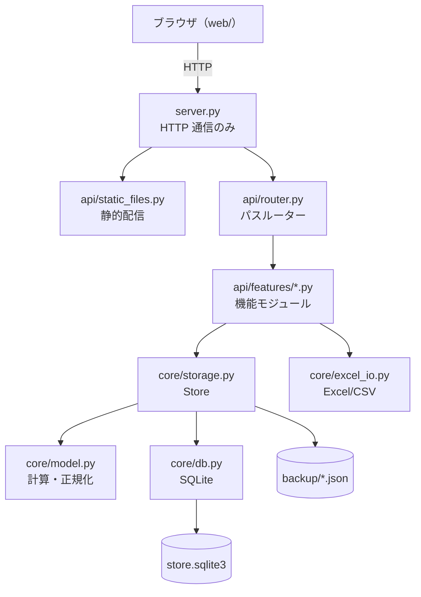

# 第2開発管理ツール 仕様書

最終更新: 2026-10-29

---

## 1. システム概要

### 1.1 目的

開発プログラム（製造・詳細設計）の実績を一元管理し、規模・工数・品質の指標を自動算出する。
あわせて、担当者が日々の業務予定と実績を日次で記録し、チームの稼働状況を可視化する。

### 1.2 構成する2つのアプリケーション

| キー | 名称 | 用途 |
| --- | --- | --- |
| `dev` | 開発プログラム管理 | タスク単位の規模・工数・品質・スケジュール管理 |
| `plan` | 業務予定管理 | 担当者単位の日次予定／実績報告 |

画面左上のタブで切り替える。設定画面は両アプリで共有する。

### 1.3 動作環境

| 項目 | 要件 |
| --- | --- |
| サーバー | Python 3.10 以降。標準ライブラリのみで動作 |
| 追加ライブラリ | `openpyxl`（Excel 入出力を使う場合のみ。無くても他機能は動作） |
| クライアント | Chromium 系 / Firefox / Edge の最新版。ビルド・npm 不要 |
| コンテナ | `python:3.12-slim`、非 root（uid 10001）で実行 |

### 1.4 設計方針

- **機能の独立化** — API のエンドポイントは機能ごとに独立したモジュールへ分割し、自動登録する
- **層の分離** — HTTP 通信（`server.py`）／API（`api/`）／ドメイン・永続化（`core/`）を分ける
- **依存の最小化** — Web フレームワークを使わず標準ライブラリで実装する
- **エンコーディング安全** — Python ソースは ASCII を保ち、日本語ラベルは JSON 定義ファイルに置く

---

## 2. アーキテクチャ

### 2.1 レイヤ構成



### 2.2 各モジュールの責務

| ファイル | 責務 |
| --- | --- |
| `tool/server.py` | HTTP の受信・応答、Host ヘッダ検証、閲覧専用モード判定、静的配信への振り分け、ログ出力、起動処理 |
| `tool/api/router.py` | `{name}` プレースホルダ対応のパスルーティング。リテラル一致を優先 |
| `tool/api/http.py` | `Request` / `Response` / `ApiError` と JSON・添付ファイル応答ヘルパ |
| `tool/api/static_files.py` | `web/` 配下の静的ファイル配信。ディレクトリトラバーサル遮断 |
| `tool/api/features/*.py` | 各機能のエンドポイント定義 |
| `tool/core/config.py` | 環境変数・CLI 引数による設定 |
| `tool/core/db.py` | SQLite スキーマ、読み書き、列追加マイグレーション |
| `tool/core/storage.py` | 業務ロジック（追加・更新・削除・取込マージ・マスタ同期）とバックアップ |
| `tool/core/model.py` | スキーマ読込、値の正規化、派生指標の計算 |
| `tool/core/excel_io.py` | Excel／CSV の読み書き |

### 2.3 リクエスト処理フロー

1. `Handler._dispatch()` が Host ヘッダを検証（`DPM_ALLOWED_HOSTS` が空なら無条件許可）
2. `/api/` 以外は `static_files.serve()` へ。GET / HEAD 以外は 404
3. 閲覧専用モードで GET / HEAD 以外なら 403 `read-only-mode`
4. `ROUTER.resolve(method, path)` でハンドラを解決
   - 未一致かつ同一パスに他メソッドが存在 → 405 `method-not-allowed`
   - 完全に未一致 → 404 `not-found`
5. ボディを読み込み（`DPM_MAX_BODY` 超過は 413）、`Request` を組み立ててハンドラを実行
6. 例外は `ApiError` → 指定ステータス、`JSONDecodeError` → 400、その他 → 500（詳細はログのみ、クライアントには `internal-error`）

### 2.4 機能モジュールの登録

`api/features/__init__.py` が `pkgutil` でパッケージ内のモジュールを列挙し、
`router` 属性を公開しているものを `api.build_router()` が統合する。
ファイルを追加・削除するだけで機能を増減できる。

```python
# tool/api/features/example.py
from ..http import Request, Response, json_response
from ..router import Router

router = Router()

@router.get("/api/example")
def example(_req: Request) -> Response:
    return json_response({"ok": True})
```

現在の登録数は 26 エンドポイント（`python server.py --routes` で確認可能）。

---

## 3. データモデル

### 3.1 論理構造

| データ | 内容 |
| --- | --- |
| `tasks` | 開発プログラムのタスク。種別 `mfg`（製造）／`dd`（詳細設計） |
| `plans` | 業務予定・実績。種別 `plan`（始業前）／`result`（終業前） |
| `entries` | 担当者 × 月の実績入力状況 |
| `masters` | 選択肢マスタと計算パラメータ |
| `savedViews` | 一覧画面のユーザー定義ビュー |
| `users` | ログインユーザー（ID・氏名・担当者名・権限・年次・担当管理者・パスワードハッシュ） |
| `meta` | スキーマバージョン、最終更新日時、セッション署名鍵（`authSecret`） |

### 3.2 SQLite スキーマ

```sql
CREATE TABLE meta        (key TEXT PRIMARY KEY, value TEXT);
CREATE TABLE masters     (key TEXT PRIMARY KEY, value TEXT NOT NULL);   -- value は JSON
CREATE TABLE tasks (
    id TEXT PRIMARY KEY, seq INTEGER NOT NULL, type TEXT,
    program_id TEXT, project TEXT, assignee1 TEXT, assignee2 TEXT,
    start_date TEXT, end_date TEXT, created_at TEXT, updated_at TEXT,
    payload TEXT NOT NULL);                                             -- payload は JSON
CREATE TABLE plans (
    id TEXT PRIMARY KEY, seq INTEGER NOT NULL, kind TEXT,
    member TEXT, project TEXT, date TEXT, end_date TEXT,
    created_at TEXT, updated_at TEXT, payload TEXT NOT NULL);
CREATE TABLE entries     (member TEXT, month TEXT, value TEXT, PRIMARY KEY (member, month));
CREATE TABLE saved_views (seq INTEGER PRIMARY KEY, value TEXT NOT NULL);
CREATE TABLE users (
    id TEXT PRIMARY KEY, seq INTEGER NOT NULL, name TEXT, member TEXT,
    role TEXT NOT NULL, password TEXT NOT NULL,                         -- role: owner / admin / user
    created_at TEXT, updated_at TEXT,
    grade TEXT, manager TEXT);                                          -- 年次・担当管理者（空欄 = 未設定）
```

`users` は JSON 出力・JSON 復元・バックアップの対象外（復元でアカウントが消えないようにするため）。
`grade` / `manager` は後から追加した列で、既存 DB には起動時に自動で追加される（既存ユーザーは未設定）。

インデックス: `tasks(seq, type, project)` / `plans(seq, date, member)`

検索・集計に使う項目は実カラムに展開し、スキーマ駆動で増減する項目は `payload`（JSON）に格納する
ハイブリッド構成。`fields.json` を変更しても DB マイグレーションは不要。

### 3.3 タスクの項目定義（`tool/core/fields.json`）

全 44 項目。`types` 列は対象種別（mfg = 製造、dd = 詳細設計）。
`fold: true` の項目（担当者②・ステータス・進捗率・使用エディタ・コンパイル回数・コンパイル内訳 MAIN・タグ・備考。登録データで使われていないもの）は、タスク編集ドロワーで「その他の項目」に折りたたんで表示する（既定は閉じる。値が入っている項目があれば見出しに「入力あり N 件」と出す）。
`unit` は入力欄の右端に出す単位（step / h / 件 / 頁 / % / 回）。

#### 基本情報

| キー | ラベル | 型 | 対象 | 選択肢 |
| --- | --- | --- | --- | --- |
| `type` | 種別 | select | mfg, dd | 製造 / 詳細設計 |
| `system` | システム | select | mfg | `systems` マスタ |
| `resource` | リソース区分 | select | mfg, dd | `resources` マスタ |
| `designType` | 設計種別 | select | dd | `designTypes` マスタ |
| `programId` | プログラムID | text | mfg, dd | —（必須） |
| `kubun` | 区分 | select | mfg, dd | `kubuns` マスタ |
| `project` | 案件名 | select-free | mfg, dd | `projects` マスタ（自由入力可）（必須） |

#### 規模

| キー | ラベル | 型 | 対象 |
| --- | --- | --- | --- |
| `baseStep` | 母体step | number | mfg |
| `newStep` | 新規step | number | mfg |
| `modStep` | 修正step | number | mfg |
| `pages` | 設計書頁数 | number | dd |

#### スケジュール

| キー | ラベル | 型 | 対象 |
| --- | --- | --- | --- |
| `startDate` | 開始日 | date | mfg, dd |
| `endDate` | 終了日 | date | mfg, dd |
| `assignee1` | 担当者① | select-free | mfg, dd |
| `assignee2` | 担当者② | select-free | mfg, dd |
| `status` | ステータス | select | mfg, dd |
| `progress` | 進捗率(%) | number | mfg, dd |

#### 工数

| キー | ラベル | 型 | 対象 |
| --- | --- | --- | --- |
| `hourMake` | 工数 製造(h) | number | mfg |
| `hourCheck` | 工数 チェックリスト(h) | number | mfg |
| `hourVerify` | 工数 検証資料(h) | number | mfg |
| `hourDesign` | 詳細設計 時間(h) | number | dd |

#### 品質

| キー | ラベル | 型 | 対象 |
| --- | --- | --- | --- |
| `issueCode` | 指摘(コーディング) | number | mfg |
| `issueCheck` | 指摘(チェックリスト) | number | mfg |
| `issueVerify` | 指摘(検証資料) | number | mfg |
| `defect` | 障害発生件数 | number | mfg |
| `issues` | 指摘件数 | number | dd |

#### その他

| キー | ラベル | 型 | 対象 |
| --- | --- | --- | --- |
| `editor` | 使用エディタ | select-free | mfg |
| `compileCount` | コンパイル回数 | number | mfg |
| `compileMain` | コンパイル内訳 MAIN | number | mfg |
| `month` | 計上月 | text | dd |
| `tags` | タグ | text | mfg, dd |
| `note` | 備考 | textarea | mfg, dd |

#### 自動計算項目（入力不可）

| キー | ラベル | 対象 |
| --- | --- | --- |
| `convStep` | 換算step | mfg |
| `totalHour` | 総工数(h) | mfg, dd |
| `testRatio` | テスト比率(%) | mfg |
| `prodNew` | 生産性 新規(step/h) | mfg |
| `prodMod` | 生産性 修正(step/h) | mfg |
| `prodMonth` | 月換算生産性 | mfg |
| `issueTotal` | 指摘合計 | mfg, dd |
| `quality` | 品質(指摘/KS) | mfg |
| `defectRate` | 障害(件/KS) | mfg |
| `pagePerHour` | 設計効率(頁/h) | dd |
| `issuePerPage` | 品質(指摘/頁) | dd |
| `durationDays` | 期間(日) | mfg, dd |

システム項目: `id`（12桁hex）、`createdAt`、`updatedAt`、`effectiveStatus`、`isLate`

### 3.4 業務予定・実績（plans）

| キー | 型 | 説明 |
| --- | --- | --- |
| `id` | text | 12桁hex |
| `kind` | text | `plan` = 始業前の予定 / `result` = 終業前の実績 / `assignment` = 取組み予定（期間）。未指定は `plan` |
| `member` | text | 担当者（氏名エイリアスで正規化） |
| `date` / `endDate` | date | 対象日。日次入力では両方同じ日付、`assignment` では開始日〜終了日 |
| `category` | text | **工程（作業区分）**。`planCategories` マスタ |
| `project` | text | 案件名 |
| `programId` / `taskId` | text | 開発タスクとの紐付け |
| `title` | text | 作業内容 |
| `hours` | number | 予定工数(h)。`plan` はその日、`assignment` は期間全体の合計。`plan` / `result` は 0〜24、`assignment` は 0 以上（範囲外は 400 `invalid-hours`） |
| `actualHours` | number | 実績工数(h)。主に `result` で使用。範囲は `hours` と同じ |
| `progress` | number | 進捗率(%)。0〜100（範囲外は 400 `invalid-progress`） |
| `status` | text | `plan` / `assignment` は `planStatuses` マスタ（予定 / 実施中 / 完了 / 中止）。`result` は **予定通り / 遅延** の 2 つ（マスタではなく固定。それ以外の値で保存されたときはサーバー側で「予定通り」にする） |
| `delayReason` | text | 遅延の理由（任意）。`result` の状況が「遅延」のときだけ保存し、それ以外は空。`payload` 内に保存（列追加なし） |
| `delayResolvedAt` / `delayResolvedBy` | text | 遅延の解消を登録した日（YYYY-MM-DD）と登録者（ログイン中ユーザーの担当者名）。状況「遅延」の `result` だけが持ち、未解消は空。遅延でなくした・新たに遅延にした実績を保存すると空に戻す。`payload` 内に保存（列追加なし） |
| `skipReason` | text | 未実施の理由（任意）。日次入力で未実施にした `plan`（状況「中止」）のときだけ保存し、それ以外は空。`payload` 内に保存（列追加なし） |
| `assignmentId` | text | **紐づく取組み予定の ID**（`plan` / `result` から参照。任意） |
| `sourceId` | text | 実績と同じ行（日次入力の予実一体シート）の予定 ID。予定外の実績は空 |
| `seriesId` | text | **定例予定**（毎週の会議など）としてまとめて登録した `plan` に共通の ID。通常の予定は空。`payload` 内に保存（列追加なし） |
| `note` | text | 備考 |
| `allDay` | bool | 終日フラグ（既定 true） |
| `updatedBy` | text | ログイン中ユーザーの担当者名（未設定なら氏名）から記録される更新者 |
| `createdAt` / `updatedAt` | text | ISO 8601（ローカルタイムゾーン付き） |

#### 取組み予定（assignment）と日次入力の関係

```
assignment  「9/7〜9/18 SDLP341 製造（予定 40h）」
   │
   ├─ plan   9/8  予定 6h      ← assignmentId で参照
   ├─ result 9/8  実績 5.5h 進捗 70%
   └─ result 9/9  実績 7h   進捗 90%
```

ロールアップはクライアント側（`State.assignmentRollup`）で算出し、DB には保存しない。

| 項目 | 算出方法 |
| --- | --- |
| 実績積上 | 紐づく `result` の `actualHours` 合計 |
| 消化率 | 実績積上 ÷ `assignment.hours` × 100 |
| 進捗率 | 紐づく `result` のうち**最新日付の進捗率**（同一日なら `updatedAt` が新しい方） |

**ステータスの自動切替**（サーバー側 `Store._sync_assignment_status`）: 紐づく `result` が変わる保存（日次入力の一括保存・単票の登録／更新・削除・一括変更）のたびに、影響する取組み予定（保存・削除した記録の、変更前後の `assignmentId`）のステータスを次の値にする。紐づく `result` なし＝**予定**、あり＝**実施中**、上の進捗率（最新日付の進捗率）が 100＝**完了**。取組み予定のエディタで手で変えたステータスはそのまま保存するが、次に紐づく実績を保存したときに自動の値で上書きする。**中止** は手で選んだまま変えない。取組み予定そのものの保存では切り替えない

取組み予定を削除すると、紐づいていた日次行は残したまま `assignmentId` のみ解除される。
取組み予定は日次の集計（ダッシュボード「本日の業務予定」・予定サマリの工数）には含めない。

### 3.5 マスタ（`tool/core/masters.json`）

| キー | 内容 |
| --- | --- |
| `systems` | システム名 |
| `resources` | リソース区分（JN / リアル / バッチ / 画面 …） |
| `resourceGroups` | リソース区分の分類（サブルーチン系・リアル系 など） |
| `kubuns` | 新規 / 修正 / 削除 / 調査 |
| `statuses` | タスクのステータス（値＋色） |
| `designTypes` | プログラム設計 / 詳細設計 |
| `editors` | 使用エディタ |
| `members` | 担当者（データから自動追加） |
| `excludedMembers` | 担当者から除外した名前。設定画面で `members` から削除した名前と特権管理者の担当者名が入り、データからの自動追加・画面の担当者一覧の対象外になる（タスク・予定のデータ自体は残る） |
| `projects` | 開発管理の案件（タスクに現れた案件を自動追加・ソート）。業務予定の案件は追加しない。一覧・入力の案件名の入力候補に使う |
| `entryStatuses` | 完了 / 対象外 / 未入力 |
| `planCategories` | **工程（作業区分）**。値＋色。製造 / 詳細設計 / 基本設計 / テスト / レビュー / 調査・解析 / 会議 / 資料作成 / 教育・研修 / 問合せ対応 / 休暇 / その他 |
| `planStatuses` | 予定 / 実施中 / 完了 / 中止（値＋色）。予定・取組み予定のステータスに使う（日次入力の実績の状況〈予定通り / 遅延〉には使わない） |
| `userGrades` | ユーザーの年次の選択肢。既定は 1年目 / 2年目 / 3年目 / 4年目以上 |
| `userManagers` | ユーザーの担当管理者の選択肢。既定は 大場 / 大前 / 伊藤高 |
| `settings` | 計算パラメータ（下記） |

#### 計算パラメータ（`masters.settings`）

| キー | 既定値 | 許容範囲 | 用途 |
| --- | --- | --- | --- |
| `baseCoef` | 0.06 | 0 以上 | 換算step の母体係数 |
| `newCoef` | 1 | 0 以上 | 換算step の新規係数 |
| `modCoef` | 2 | 0 以上 | 換算step の修正係数 |
| `monthHours` | 150 | 1 以上 | 月換算生産性の基準時間 |
| `fiscalStartMonth` | 4 | 1〜12 の整数 | 年度開始月 |
| `workHoursPerDay` | 7.5 | 1〜24 | 1人日あたり時間 |
| `targetProdMonth` | 800 | 0 以上 | 目標 月換算生産性 |
| `targetQuality` | 50 | 0 以上 | 目標 品質（指摘/KS の上限） |
| `sourceExcel` | 開発プログラム一覧_R7.xlsx | — | 既定の取込ファイル名 |

数値は有限値のみ受け付ける（NaN・Infinity は不可）。範囲外の値を含む更新は 400 `invalid-settings` とし、保存済みの設定は変更しない。

### 3.6 列挙値（`tool/core/enums.json`）

| キー | 値 |
| --- | --- |
| `status` | todo=未着手 / doing=進行中 / review=レビュー中 / done=完了 / hold=保留 / na=対象外 |
| `kubun` | new=新規 / mod=修正 |
| `entry` | done=完了 / na=対象外 / todo=未入力 |
| `sample` | 取込時に除外する行の接頭辞（「例）」「例」「sample」） |
| `memberAlias` | 表記ゆれの吸収（例: `伊藤（ま）` → `伊藤(ま)`、`𠮷田` → `吉田`） |

---

## 4. 計算仕様

すべて `core/model.py` の `compute()` で算出する。タスクの保存時、および
`GET /api/tasks` / `GET /api/bootstrap` の応答生成時に再計算される。

### 4.1 製造（mfg）

$$\text{換算step} = \begin{cases} \text{新規step} \times C_{new} & (\text{区分}=\text{新規}) \\ \text{母体} \times C_{base} + \text{修正step} \times C_{mod} & (\text{それ以外}) \end{cases}$$

$$\text{総工数} = \text{製造} + \text{チェックリスト} + \text{検証資料}$$

$$\text{テスト比率(\%)} = \frac{(\text{チェックリスト} + \text{検証資料}) \times 100}{\text{総工数}}$$

$$\text{生産性 新規} = \frac{\text{新規step}}{\text{製造工数}} \qquad \text{生産性 修正} = \frac{\text{修正step}}{\text{製造工数}}$$

$$\text{月換算生産性} = \frac{(\text{区分}=\text{新規 なら 新規step、それ以外は 修正step}) \times \text{monthHours}}{\text{総工数}}$$

換算step・月換算生産性は「開発プログラム一覧」Excel の数式（`IF(区分="新規", …)`）と同じく区分で式を切り替える。

$$\text{指摘合計} = \text{コーディング} + \text{チェックリスト} + \text{検証資料}$$

$$\text{品質(指摘/KS)} = \frac{\text{指摘合計} \times 1000}{\text{換算step}} \qquad \text{障害(件/KS)} = \frac{\text{障害件数} \times 1000}{\text{換算step}}$$

丸め: 換算step・総工数・生産性は小数2桁、テスト比率・月換算生産性は小数1桁、指摘合計は整数。

### 4.2 詳細設計（dd）

$$\text{総工数} = \text{詳細設計時間} \qquad \text{設計効率(頁/h)} = \frac{\text{頁数}}{\text{時間}} \qquad \text{品質(指摘/頁)} = \frac{\text{指摘件数}}{\text{頁数}}$$

製造専用の指標（換算step・テスト比率・生産性・品質・障害率）は `null` になる。

### 4.3 共通

- `durationDays` = 終了日 − 開始日 + 1（開始・終了が揃い、終了 ≧ 開始のときのみ）
- 分母が 0 または未入力の場合、結果は `null`（0 除算・NaN・Inf は出力しない）

### 4.4 実効ステータス（`effectiveStatus`）

`status` が明示されていればそれを採用。未設定の場合は日付から推定する。

| 条件 | 実効ステータス |
| --- | --- |
| 終了日 < 本日 | 完了 |
| 開始日 ≦ 本日 かつ（終了日なし または 終了日 ≧ 本日） | 進行中 |
| 開始日 > 本日 | 未着手 |
| 開始日なし・終了日なし | 未着手 |
| 開始日なし・終了日あり | 進行中 |

### 4.5 遅延判定（`isLate`）

実効ステータスが「完了」「対象外」以外で、かつ `終了日 < 本日` の場合に `true`。

### 4.6 値の正規化

| 対象 | 処理 |
| --- | --- |
| 数値 | NFKC 正規化 → カンマ・`%` 除去 → float。変換不能は `null`。真偽値は `null` |
| 日付 | `datetime` / `date` / 文字列（`/` `.` を `-` に変換）→ ISO `YYYY-MM-DD`。不正は `null` |
| 文字列 | 前後空白除去。空文字は `null` |
| 担当者名 | NFKC 正規化 → 空白除去 → `memberAlias` で置換 |
| Excel 見出し | NFKC 正規化 → 空白除去 → 小文字化して照合 |

---

## 5. API 仕様

- ベースパス: `/api`
- 形式: リクエスト・レスポンスともに JSON（UTF-8）
- 共通レスポンスヘッダ: `Cache-Control: no-store`、`X-Content-Type-Options: nosniff`
- エラー形式: `{"error": "<コード>"}`
- 認証: Cookie `dpm_session` によるセッション（詳細は「5.4 認証・権限」）
- 更新者の記録: ログイン中ユーザーの担当者名（未設定なら氏名、40文字まで）

### 5.1 エンドポイント一覧（34件）

権限列: 公開 = ログイン不要、一般 = ログイン必須、管理者 = 管理者のみ（無印は一般）。

| メソッド | パス | 概要 |
| --- | --- | --- |
| GET | `/api/health` | 死活監視（公開） |
| POST | `/api/auth/login` | ログイン（公開） |
| POST | `/api/auth/logout` | ログアウト（公開） |
| GET | `/api/auth/me` | ログイン中ユーザーの取得 |
| PUT | `/api/auth/password` | 自分のパスワード変更 |
| GET | `/api/users` | ユーザー一覧（管理者） |
| POST | `/api/users` | ユーザー追加（管理者） |
| PUT | `/api/users/{user_id}` | ユーザー更新・パスワード初期化（管理者） |
| DELETE | `/api/users/{user_id}` | ユーザー削除（管理者） |
| GET | `/api/bootstrap` | 初期化用の全データ一括取得 |
| GET | `/api/version` | 最終更新日時のみ取得（ポーリング用） |
| GET | `/api/files` | 取込フォルダの Excel 一覧 |
| GET | `/api/tasks` | タスク一覧（再計算込み） |
| POST | `/api/tasks` | タスク追加 |
| PUT | `/api/tasks/{task_id}` | タスク更新 |
| DELETE | `/api/tasks/{task_id}` | タスク削除 |
| POST | `/api/tasks/bulk` | タスク一括操作（`delete` は管理者） |
| GET | `/api/plans` | 予定・実績一覧 |
| POST | `/api/plans` | 予定・実績の追加（複数日一括可） |
| PUT | `/api/plans/{plan_id}` | 更新 |
| DELETE | `/api/plans/{plan_id}` | 削除 |
| POST | `/api/plans/bulk` | 一括操作 |
| PUT / POST | `/api/masters` | マスタ更新（全タスク再計算）（管理者） |
| PUT / POST | `/api/entries` | 月次入力状況の設定 |
| PUT / POST | `/api/views` | 保存ビューの更新 |
| GET | `/api/export/csv` | CSV 出力 |
| GET | `/api/export/excel` | Excel 一括出力 |
| GET | `/api/export/json` | 全データ JSON 出力 |
| POST | `/api/import/excel` | フォルダ内 Excel の取込（`mode=replace` は管理者） |
| POST | `/api/import/csv` | CSV テキストの取込（`mode=replace` は管理者） |
| POST | `/api/import/json` | JSON バックアップからの復元（管理者） |

### 5.2 主要エンドポイント詳細

#### `GET /api/bootstrap`

画面初期化に必要なすべてを返す。

```jsonc
{
  "schema":    { "types": [...], "fields": [...] },
  "enums":     { "status": {...}, "kubun": {...}, ... },
  "masters":   { "members": [...], "settings": {...}, ... },
  "tasks":     [ ... ],
  "plans":     [ ... ],
  "entries":   { "担当者名": { "2026-04": "完了" } },
  "savedViews":[ ... ],
  "folder":    "取込フォルダの絶対パス",
  "dataDir":   "データフォルダの絶対パス",
  "database":  "SQLite ファイルの絶対パス",
  "backupKeep": 30,
  "hasExcel":  true,      // openpyxl が利用可能か
  "readOnly":  false,
  "shared":    false,     // ループバック以外で待ち受けているか
  "updatedAt": "2026-09-08T17:53:43+09:00",
  "account":   { "id": "A250028", "name": "岡本 央渉", "member": "岡本", "role": "admin" },
  "memberAttrs": { "担当者名": { "grade": "1年目", "manager": "大場" } }  // 特権管理者を除くユーザーの属性。manager は管理者（特権管理者を含む）にのみ返す
}
```

#### `POST /api/tasks` / `PUT /api/tasks/{task_id}`

リクエストはタスク項目のオブジェクト。未知のキーは無視され、対象種別に属さない項目も除外される。
計算項目はサーバー側で上書きされる。

- プログラムID・案件名は両方必須。`POST` で空（空白のみを含む）なら 400 `task-required`。`PUT` と bulk `patch` は、送られてきたときだけ空でないことを確認する
- 数値の項目は 0 以上（負の値は 400 `invalid-number`）、進捗率は 0〜100（範囲外は 400 `invalid-progress`）
- Excel / CSV / JSON の取込はこの API を通らないため、これらの確認の対象外
- 応答: `{"task": { ... }}`
- 該当 ID なし: 404 `not-found`

#### `POST /api/tasks/bulk`

```jsonc
{ "action": "delete", "ids": ["id1", "id2"] }
{ "action": "patch",  "ids": ["id1"], "patch": { "status": "完了" } }
```

- 応答: `{"removed": n}` または `{"updated": n}`
- `delete` は管理者のみ。一般ユーザーは 403 `forbidden`
- 未知の `action`: 400 `unknown-action`

#### `POST /api/plans`

単票登録に加え、`dates` を渡すと同一内容を複数日へ一括作成する。

```jsonc
// 単票
{ "kind": "plan", "member": "山田", "date": "2026-09-08",
  "category": "製造", "title": "SDLP341 修正", "hours": 4 }
// 複数日
{ "kind": "plan", "member": "山田", "category": "会議", "hours": 1,
  "dates": ["2026-09-09", "2026-09-10"] }
```

- 応答: `{"plan": {...}}` または `{"plans": [...], "added": n}`
- `hours` / `actualHours` は `plan` / `result` で 0〜24、`assignment` で 0 以上。範囲外は 400 `invalid-hours`
- `progress` は 0〜100。範囲外は 400 `invalid-progress`（`/api/plans/batch`・`PUT`・bulk `patch` も同じ）
- `updatedBy` にログイン中ユーザーの担当者名が記録される
- 定例予定の登録は、担当者ごとに `dates`（指定曜日の日付一覧）と共通の `seriesId` を付けてこの API を呼ぶ。定例の「この日以降を削除」は `POST /api/plans/bulk`（`action: delete`）で行う

#### `GET /api/export/csv`

| クエリ | 既定 | 説明 |
| --- | --- | --- |
| `type` | `mfg` | `mfg` または `dd` |
| `ids` | （全件） | カンマ区切りの ID で絞り込み |

UTF-8 BOM 付き、改行 CRLF。ファイル名は `製造_一覧.csv` 等（RFC 5987 形式）。

#### `POST /api/import/excel`

```jsonc
{ "file": "開発プログラム一覧_R7.xlsx", "mode": "upsert", "withEntries": true }
```

- `file` は取込フォルダ直下のファイル名のみ。パス区切り文字や先頭 `.` を含む場合は拒否
- `mode`: `upsert`（既定）／`append`／`replace`。`replace` は管理者のみ（一般ユーザーは 403 `forbidden`）。`POST /api/import/csv` も同じ
- 応答: `{"added": n, "updated": n, "skipped": 0, "detail": {...}, "sheets": [...]}`
- 該当ファイルなし: 404 `file-not-found`

#### `POST /api/import/json`

```jsonc
{ "data": { "tasks": [...], "masters": {...}, "entries": {...} } }
```

含まれるキーのみ置換する。`tasks` を含む場合は**全タスクを置き換える**破壊的操作。
マスタ（設定）も上書きするため管理者のみ実行できる。`users` は含まれていても無視する。

### 5.3 エラーコード

| ステータス | コード | 発生条件 |
| --- | --- | --- |
| 400 | `invalid-json` | リクエストボディが JSON として不正 |
| 400 | `unknown-action` | bulk の `action` が未知 |
| 400 | `invalid-user-id` / `name-required` / `invalid-role` / `invalid-grade` / `invalid-manager` | ユーザー追加・更新の入力不正（年次・担当管理者はマスタにない値） |
| 400 | `weak-password` | 新しいパスワードが 4 文字未満 |
| 400 | `wrong-password` | パスワード変更時の現在のパスワード誤り |
| 400 | `last-admin` | 最後の管理者を降格・削除しようとした |
| 400 | `cannot-delete-self` | 自分自身を削除しようとした |
| 400 | `invalid-hours` | 予定・実績の工数が範囲外（`plan` / `result` は 0〜24、`assignment` は 0 以上） |
| 400 | `invalid-progress` | 進捗率が 0〜100 の範囲外 |
| 400 | `task-required` | タスクのプログラムID・案件名が空 |
| 400 | `invalid-number` | タスクの数値の項目（step・工数・指摘など）が負の値 |
| 400 | `invalid-settings` | 計算パラメータが許容範囲外（3.5） |
| 401 | `unauthorized` | 未ログイン・セッション期限切れ |
| 401 | `login-failed` | ID またはパスワードの誤り |
| 403 | `host-not-allowed` | Host ヘッダが `DPM_ALLOWED_HOSTS` に含まれない |
| 403 | `read-only-mode` | 閲覧専用モードで更新系を呼び出した |
| 403 | `forbidden` | 管理者専用 API を一般ユーザーが呼び出した（全件置換の取込・タスク一括削除を含む）／静的配信でディレクトリ外を参照した |
| 403 | `forbidden-member` | 一般ユーザーが他の担当者の予定・実績・取組み予定を登録・変更・削除しようとした |
| 404 | `not-found` | 該当リソース／ルートなし |
| 409 | `user-exists` | 同じ ID のユーザーが既に存在する |
| 404 | `file-not-found` | 取込対象ファイルが存在しない |
| 405 | `method-not-allowed` | パスは存在するがメソッドが未対応 |
| 413 | `payload-too-large` | ボディが `DPM_MAX_BODY` を超過 |
| 500 | `openpyxl-missing` | Excel 出力時に openpyxl が未インストール |
| 500 | `internal-error` | 想定外の例外（詳細はサーバーログのみに出力） |

### 5.4 認証・権限

| 項目 | 内容 |
| --- | --- |
| ログイン | ID とパスワード。失敗時は 0.6 秒待ってから 401 `login-failed` を返す（総当たり抑止） |
| パスワード保存 | PBKDF2-SHA256（12 万回、ソルト付き）。平文は保存しない |
| セッション | Cookie `dpm_session`（`HttpOnly; SameSite=Strict`）。ユーザー ID・有効期限を HMAC-SHA256 で署名 |
| 有効期限 | `DPM_SESSION_HOURS`（既定 12 時間）。期限切れは 401 `unauthorized` |
| 署名鍵 | 初回起動時に生成し `meta.authSecret` に保存 |
| 無効化 | 署名にパスワードハッシュを含むため、パスワード変更・初期化で既存セッションは無効になる |
| 初期ユーザー | `users` が空のとき `tool/core/users.json` から作成。初期パスワードは ID と同じ |
| 権限 | `owner`（特権管理者）／`admin`（管理者）／`user`（一般） |
| 属性 | 年次 `grade`・担当管理者 `manager`。選択肢はマスタ `userGrades` / `userManagers`（設定画面で追加・削除）で、空欄（未設定）可。一般・管理者のみ設定でき、特権管理者は保存時に空欄にする。マスタから外した値は設定済みのユーザーには残り（他の項目の更新でも消えない）、新たには設定できない |

特権管理者は管理者と同じ権限を持つ閲覧主体のユーザーで、担当者名を `excludedMembers` に登録し担当者から除外する（日次入力の入力対象・実績入力確認・担当者ビューなどの担当者一覧に表示しない）。日次入力などの既定の担当者は、ログインユーザーが担当者に含まれない場合は担当者一覧の先頭とする。

管理者（特権管理者を含む）のみ可能な操作:

- ユーザーの追加・編集・削除・パスワード初期化（`/api/users`）
- 設定画面（マスタ・計算パラメータ）の編集（`/api/masters`）
- JSON バックアップからの復元（`/api/import/json`）
- Excel / CSV 取込の全件置換（`mode=replace`）
- タスクの一括削除（`/api/tasks/bulk` の `delete`）

一般ユーザーはタスク・予定の登録・編集、Excel / CSV 取込（更新＋追加・すべて追加）、出力を利用できる。画面では全件置換の選択肢と一括削除ボタンを管理者にのみ表示する。
ただし業務予定（予定・実績・取組み予定、`/api/plans` 系）は、ログインアカウントの担当者名と一致する記録のみ登録・変更・削除できる（サーバー側で `forbidden-member`）。閲覧は全員分可能。画面では日次入力の担当者を自分に固定し、他の担当者の記録は閲覧専用で開く。
最後の管理者（特権管理者を含む）は降格・削除できない。自分自身は削除できない。

---

## 6. 画面仕様

画面の構成と遷移経路は [画面遷移図.md](画面遷移図.md) を参照。

### 6.1 共通レイアウト

- 左サイドバー: アプリ切替タブ、機能グループ別ナビゲーション、件数バッジ（一覧・入力＝タスク件数、担当者ビュー＝担当者数、ダッシュボード＝遅延タスク件数。業務予定は件数が増え続けるため表示しない）
- サイドバーの表示／非表示: 下部の「‹‹ メニューを隠す」で完全に隠し、上部バー左端の ☰ で表示／非表示を切り替える。状態は `localStorage`（キー `dpm.navHidden`）に保存し、再読込後も保持する。切り替え後はガント・グラフなど幅に合わせて描く画面を描き直す（未保存の変更がある画面は描き直さない）。幅 900px 以下の画面ではサイドバーを本体に重ねて表示し、☰ で開閉、ナビ項目の選択・「メニューを隠す」で閉じる
- 上部バー: 画面タイトル、アカウントバッジ（氏名、管理者は「（管理者）」、特権管理者は「（特権管理者）」付き）、横断検索（Ctrl+K）。新規登録は各画面内のボタン（一覧・入力の「＋ 新規登録」、メンバーの「＋ タスク追加」、取組み予定の「＋ 取組み予定を登録」、日次入力の「＋ 作業を追加」、チーム予定ボードの「＋ 予定を登録」）から行う（上部バーの共通の新規登録ボタン・Ctrl+N は廃止）
- 横断検索は管理者のみ、検索に対応した画面（一覧・入力、ガントチャート、取組み予定、チーム予定ボード）でのみ表示する。対応していない画面へ移ると検索条件を解除する
- 未ログイン時はログイン画面を表示する。最後にログインした ID は `localStorage`（キー `dpm.loginId`）に保存し次回入力欄に補完する
- アカウントバッジからアカウント情報の確認・パスワード変更・ログアウトができる
- 操作中にセッションが切れた場合はログイン画面を重ねて表示し、同じユーザーで再ログインすれば編集中の画面をそのまま継続できる
- 設定画面は管理者にのみ表示される（一般ユーザーはナビゲーションに表示されず、URL 直接指定も遮断）
- 20 秒ごとに `GET /api/version` をポーリングし、更新があれば再取得して再描画する（ドロワー表示中、および未保存の変更がある画面の表示中は抑止）
- 未保存の変更がある画面（日次入力・設定）から他の画面やアプリへ移るときは「保存していない変更があります。破棄して移動しますか？」を確認する。ページを閉じる・再読込時はブラウザの離脱確認を出す

### 6.2 開発プログラム管理

| 画面 | 主な機能 |
| --- | --- |
| **ダッシュボード** | 進行中／遅延／今月完了／着手予定／月換算生産性／品質／投入工数／登録総件数の KPI、担当者別の稼働状況 |
| **一覧・入力** | 全項目の表形式表示。セルのダブルクリックでインライン編集、計算項目クリックで詳細ドロワー。列の絞り込み・並べ替え・保存ビュー・CSV 出力。入力の詳細は 6.2.1 |
| **担当者ビュー** | 担当者カードごとの担当件数・進行中作業・今月実績（件数／換算step／工数／生産性）・当日の予定と実績チップ |
| **ガントチャート** | 担当者／案件／リソース区分／なし でグルーピング。表示期間は約1.5ヶ月・約3.5ヶ月・約7ヶ月・全期間。ステータス色分けと遅延強調、未完了のみ表示 |
| **分析** | 観点（担当者・案件・リソース区分・リソース分類・システム・区分・エディタ・月・年度・ステータス）× 指標（件数・各種step・工数・指摘・障害・生産性・品質）のグラフと表 |
| **クロス集計** | 任意2軸のピボット。合計行・列付き |
| **実績入力確認** | 担当者 × 月（年度単位）のマトリクス。セルクリックで 完了／対象外／未入力 を切替、入力率を表示。その下に担当者ごとの **経験本数**（新規／修正）を表示：製造タスクのうちリソース区分が `JN`・`リアル`・`RD`（完全一致）、区分が新規・修正のものを、担当者①②のどちらかに名前がある件数として全期間で数え、合計とリソース区分ごとの本数を出す。合計の列は氏名のすぐ右に置き、青い背景・大きめの太字で強調し、内訳（JN・リアル・RD）との間を青い太線で区切る（ステータス「対象外」は除く。SQL・bjex などの他のリソース区分は数えない）。年度の選択には連動しない |
| **取込 / 出力** | フォルダ内 Excel 取込（3モード。全件置換は管理者のみ表示）、CSV 取込（ドロップ／貼り付け）、Excel・CSV・JSON 出力、JSON からの復元（管理者のみ表示）、ログイン中ユーザーと共有状態の案内 |
| **設定**（管理者のみ） | ユーザー管理（追加・編集・パスワード初期化・削除。一般・管理者には年次・担当管理者を設定できる）、年次・担当管理者の選択肢（ユーザー管理の直下）、計算パラメータの編集（保存で全件再計算。許容範囲外は保存しない）、各マスタの追加・削除・並べ替え・色設定。保存はカード単位で、他のカードの未保存の編集は保持する |

#### 6.2.1 一覧・入力の入力

- 一覧の上の「＋ 新規登録」でタスク編集ドロワー（全項目）を開く
- 各行の左（# の右）の「入力」列に操作ボタンを置く（横スクロールしなくても押せる）
  - 実績未入力（工数が 1 つも入っていない ＝ 総工数が空）の行は青い「実績入力」、入力済みの行は「編集」。⋯ は詳細ドロワー
  - 「実績入力」は実績入力ドロワーを開く。上にタスクの見出し（種別・プログラムID・案件名・区分・リソース区分・システム・担当者・期間。編集不可）を出し、入力欄は規模（step）・品質（指摘・障害）・工数のみ。「すべての項目を編集」で全項目のタスク編集ドロワーに切り替える（入力中の値は引き継ぐ）。削除・複製はできない
  - 「編集」はタスク編集ドロワー（全項目）を開く
- 着手済み（ステータスが未着手・対象外以外）で実績未入力の行は、ステータスの横に「実績未入力」を表示し、表示中の列のうち空いている実績の項目のセルを薄いオレンジにする。実績の項目は、製造が step（区分が新規なら新規step、それ以外は母体step・修正step）・指摘 3 種・工数 3 種、詳細設計が設計書頁数・指摘件数・詳細設計時間
- タスク編集ドロワー・実績入力ドロワー共通
  - 自動計算の項目は入力欄にせず、フォームの下に固定した「計算結果」に数値だけを表示し、入力に合わせてその場で更新する
  - 製造の step 欄は区分に合わせて、使わない欄を「入力不要」にする（新規なら母体step・修正step、新規以外なら新規step。区分が未選択なら対象なし）。ラベルに「入力不要」のマークを付け、入力欄は斜線の灰色で入力できない。保存時に入力不要の欄の値は消去する（値が残っているときはマークを「入力不要（保存時に消去）」にする）。分析・クロス集計の新規step・修正step の合計に、使わない欄の値が混ざらないようにするため
  - 使われていない項目（3.3 の `fold`）は「その他の項目」に折りたたむ
  - 見出しに番号（① 基本情報 ② 規模 …）と「入力済み N/M」を出す（M は表示中の欄の数。入力不要の step 欄は数えない。すべて入力済みなら緑）
  - プログラムID・案件名は両方必須。ラベルに「必須」のマークを付け、空いている欄をオレンジ枠にする。実績入力ドロワーでは、空いている実績の欄もオレンジ枠にする
  - 保存前に確認し、問題があれば保存せずに理由を表示する: プログラムID・案件名が空（前後の空白は除いて判定）、数値の項目が負、進捗率が 0〜100 の範囲外、終了日が開始日より前。実績入力ドロワーでプログラムID・案件名が空のときは「すべての項目を編集」から入力するよう案内する
  - 数値の欄は入力欄の右端に単位（3.3 の `unit`）を出す
  - 新規登録では、ログイン中の人が担当者（担当者一覧にいる）なら担当者①の初期値にする
- 一覧の表
  - 見出しの上にグループの色の帯（基本情報・期間・体制・規模・工数・品質・算出指標）を出す。合計の列（換算step・総工数・指摘合計）は元の入力のグループ、期間(日) は期間・体制、ステータスは基本情報の帯に含め、それ以外の算出指標は「算出指標」の帯にする。帯と見出しは縦スクロールしても上に固定する
  - 自動計算の列は見出し・セルとも灰色の背景にする（マウスを重ねると「自動計算（入力不可）」と式を表示）
  - 直接編集できるセルはマウスを重ねると ✎ を出す
  - 入力不要の step のセル（区分が新規の母体step・修正step、新規以外の新規step）は灰色にし、値がなければ「—」を出す。直接編集はできない
  - セルの直接編集でも編集ドロワーと同じ確認（必須・負の値・進捗率・期間）をする。区分を変えて入力不要になる step に値があるときは「…を消去します。よろしいですか？」と確認し、変更するとその値を消す（キャンセルなら区分も変えない）
  - 進捗率が未入力のセルは空欄にする（0% と区別する）。進捗率は使われていないため既定の表示列から外した（「⚙ 列表示」で表示できる。列の設定を保存済みの人はそのまま）
- 絞り込み
  - 1 段目に種別・キーワード・担当者・クイックを置き、案件・ステータス・区分・リソース区分・期間は「詳細条件」で開く 2 段目に置く（開閉の状態は保存。閉じていても、指定中の条件の数を「詳細条件（N）」と表示し、ボタンを青くする）
  - クイックに「自分の担当」（担当者①②のどちらかがログイン中の人）を追加。ログイン中の人が担当者のときだけ表示する
  - クイックの「工数未入力」を「実績未入力」に改名し、「実績入力」ボタンと同じ基準（総工数が空）にそろえた（従来は総工数 0h も含めていた）

### 6.3 業務予定管理

業務予定（予定・実績・取組み予定）は全員分を閲覧できるが、一般ユーザーが登録・変更・削除できるのは自分の担当者の記録のみ（5.4）。
他の担当者の記録を開いた場合、エディタは閲覧専用（「記録を表示」「取組み予定を表示」）で開き、保存・削除ボタンを出さない。
権限による画面ごとの動作の違いは [画面遷移図.md](画面遷移図.md) の 5.2 を参照。

#### 取組み予定（`planAssign`）

- 一定期間取り組む作業（`kind = assignment`）を担当者 × 日付のガント形式で表示。表示日数 14 / 28 / 42 / 60 日、「‹‹ 前へ」「今日」「次へ ››」で期間を移動
- 絞り込み: 担当者・ステータス・完了も表示
- 各行に予定h、実績h（紐づく日次実績の合計）、消化率、進捗（紐づく実績のうち最新日の進捗率）を表示。「未紐づけの実績」件数を KPI に表示
- **実績なしの強調**: 開始日が今日より前（開始日を過ぎた）で、紐づく日次実績（`result`）が 1 件もない取組み予定は、行を薄い赤の背景にし、左端に赤い線、作業内容の上に赤い「⚠ 実績なし」のラベルを付け、進捗の「実績未入力」を赤い太字にする。マウスを重ねると「開始日（…）を過ぎていますが、日次入力の実績が 1 件も紐づいていません」。ステータスが「完了」「中止」のものは対象外。紐づいているのが予定（`plan`）だけの場合も対象。表の下の凡例に説明を表示
- 「＋ 取組み予定を登録」／行クリックで取組み予定エディタを開く。エディタの担当者は一般ユーザーは自分に固定
- 取組み予定の新規登録はこの画面からのみ行う（日次入力には登録ボタンを置かない）
- エディタの「開発タスクと紐付け」は、担当者が担当（担当者1・担当者2）の開発タスクのみを候補にする。一般ユーザーは自分のタスク、管理者は選択した担当者のタスク（担当者を変えると候補を入れ替える）。既に紐付け済みのタスクは担当外でも候補に残す。日次記録エディタも同じ

#### 日次入力（`planInput`）

1日単位で、担当者本人が始業前・終業前の2回入力する画面。1作業＝1行の **予実一体シート** で、
同じ行の左側に予定（`plan`）、右側に実績（`result`）を入力する。

| 領域 | 内容 |
| --- | --- |
| 操作バー | 担当者選択（一般ユーザーは自分に固定）、対象日（日付入力・前日・本日・翌日）、☀ 始業前 / 🌙 終業前 の入力済みチップ（予定の合計が基準に足りないときは ⚠ 不足表示）、「前営業日の予定を複製」（定例予定・休暇は除く。休暇の日は飛ばす）、「🔁 定例予定を登録」、「🏖 休暇登録」 |
| 未解消の遅延（シートの上・該当があるときだけ） | 表示中の担当者の、状況「遅延」で解消を登録していない実績を期間に関係なく日付の古い順に一覧表示（日付・工程・案件名・作業内容・進捗・遅延の理由）。見出しは「⚠ 未解消の遅延（N 件）」で赤枠。各行の「✓ 解消」で、その実績だけに解消日（当日）と登録者を保存する（シートの未保存の変更とは別に即時保存。シートの未保存の変更は残る）。当日に解消したものは「✓ 解消済み」と「取消」を付けて一覧に残し、取消で解消の記録を消す。翌日以降は一覧から消える |
| シート（作業） | 工程・案件名・作業内容・取組み予定。🔗 で PJCD / 作業コードを表示。取組み予定を選ぶと工程・案件名・コードを自動入力。定例予定の行には「🔁 定例」を表示。工程の選択肢に「休暇」は出さない（休暇は「🏖 休暇登録」から登録）。案件名の列は幅 260px で、マウスを重ねると全文を表示（表の最小幅 1150px。狭い画面では横スクロール） |
| 案件名の候補 | 自由入力＋候補（`datalist`）。候補は開発タスクと業務予定（全員分）の案件名。表示中の担当者が自分の予定・実績・取組み予定で使った案件を、対象日の新しい順に先頭に並べ、「自分の予定で使用」（管理者が他の担当者を表示しているときは「○○ の予定で使用」）のラベルを付ける。残りは文字コード順。チーム予定ボードの「＋ 予定を登録」は担当者欄の担当者（変更すると切り替え）、「🔁 定例予定を登録」はログインユーザーの案件を先頭にする |
| シート（休暇の行） | その日の工程「休暇」の予定を先頭に「🏖 休暇」の行として表示（区分・備考・予定h。編集不可）。✕ で取り消し、保存で削除。休暇の行がある日は空の入力行を自動では追加しない。休暇の予定h も合計行・予定合計のチェックに含める |
| シート（☀ 予定） | 予定h。予定外の行は「予定外」と表示。予定h が空欄・0 の予定の行に実績を入れると、行を灰色にして「保存すると予定外（突発作業）の実績になる」ことを示す |
| シート（🌙 実績） | 実績h（空欄なら予定h を採用。予定h をプレースホルダ表示）・差（実績−予定）・進捗率（0/25/50/75/100 のボタン＋数値入力）・状況（**予定通り / 遅延 / 未実施**。既定は予定通り。未実施は予定のある行だけ選べる。列幅 120px）。「遅延」を選ぶと選択欄を赤く、「未実施」を選ぶと灰色にし、その下に「遅延の理由（任意）」「未実施の理由（任意）」の入力欄を出す。実績が未入力の行（未実施を除く）は状況を薄く表示する。未実施の行は実績h の欄に赤字で「未実施」を表示し、差は −予定h。終業前の時間帯（当日 15 時以降・過去日）は見出しを強調 |
| 行追加 | 「＋ 作業を追加（予定）」「＋ 予定外の作業を追加（実績のみ）」 |
| 合計行 | 予定h・実績h 合計、差、1人日（設定値）に対する工数バー、平均進捗。予定h 合計が基準に足りないときは赤色で表示 |
| 保存バー（画面下に固定） | 未保存件数、進捗率未入力件数、予定の合計不足（「⚠ 予定の合計 Xh（基準 7.5h に Yh 不足）」）、💾 保存（Ctrl+S でも保存） |
| 前回の入力（折りたたみ・参照のみ） | 対象日より前で直近 7 日以内に休暇以外の入力がある日（土日・休暇の日は飛ばす。休暇の日は 7 日に数えないので、長期休暇明けでも休暇前の入力を表示。最大 62 日前まで）の、工程・案件名・作業内容・予定(h)・実績(h)・進捗・状況（遅延は赤字で「⚠ 遅延」、マウスを重ねると理由を表示）。編集不可 |
| 終業前の入力済み | その日の実績がある、予定を未実施にした（状況「中止」の予定がある）、または終日休暇の日。入力済みチップは「✓ 2件 3.0h・未実施 1件」のように未実施の件数も表示 |
| チーム入力状況（折りたたみ・管理者のみ） | 全メンバーの 始業前・終業前 の ✓/未（未実施だけの日は「✓ 済（未実施のみ）」）、予定(h)、実績(h)、平均進捗。予定の合計が基準に足りない担当者は始業前を「⚠ Xh 不足」、予定(h) を赤字で表示（入力済み人数にも数えない）。行クリックでその担当者に切替 |
| 休暇日の扱い | その日の予定がすべて工程「休暇」で、休暇の時間の合計が基準（1人日）以上（または時間が空欄の休暇＝休暇登録の導入前の入力）の場合、終業前入力は不要として ✓（「休暇のため不要」「✓ 済（休暇）」）と表示する。午前休・午後休・時間休だけの日は済にしない |

**保存の仕組み**

- 1回の保存で予定・実績をまとめて `/api/plans/batch` に送る。実績は `sourceId` で同じ行の予定と結び付く
- 実績h・進捗率のどちらかが入っていれば実績ありとみなす。両方を空にして保存すると実績のみ削除する
- **未実施（予定していたがやらなかった作業）**: 予定の行で状況を「未実施」にすると、実績h・進捗率なしで保存でき、実績（`result`）は作らない（既存の実績は削除）。予定の状況を「中止」にし、進捗率（作業全体の進み具合。任意）と理由（`skipReason`。任意）は予定に残す。未実施を選ぶと実績h の入力は消す。未実施の予定は実績工数・平均進捗に数えず、終業前は入力済みとして扱う
- **未実施への自動切替**: 実績h に 0、または実績h が空欄で進捗率 0 を入れると、状況を自動で「未実施」にする。自動で未実施にした行（保存済みの進捗 0% の未実施を含む）は、0 以外の進捗率か 0 より大きい実績h を入れ直すと「予定通り」に戻す。手で未実施を選んだ行は、実績h（0 より大きい値）を入れると「予定通り」に戻す（進捗率だけなら未実施のまま）。未実施から他の状況に変えたときは、未実施の印の 0h・0% を消す
- **突発作業（予定外）**: 予定h が空欄・0 の予定の行に実績を入れた場合は、予定（`plan`）を作らず（既存の予定は削除）、`sourceId` のない予定外の実績として保存する。この場合は実績h（0 より大きい値）が必須
- **状況（予定通り / 遅延）**: 実績の `status` に保存する。進捗率とは連動しない（作業の完了は進捗率 100 で表す）。「遅延」のときは理由を `delayReason` に保存し、それ以外に変えると理由を消す。解消の記録（`delayResolvedAt` / `delayResolvedBy`）は、遅延のまま保存し直したときは保存済みの値を残し、遅延でなくしたとき・新たに遅延にしたときは消す
- ✕ で行を削除すると、予定・実績の両方を削除対象にする

**バリデーション**

- 工程（作業区分）は必須。未選択の行があると保存しない
- 予定外の行は実績（実績h または進捗率）が必須
- 予定h が空欄・0 の予定の行に実績を入れた場合（突発作業として保存）は、実績h（0 より大きい値）が必須
- 実績（`result`）は進捗率が必須
- 予定h・実績h は 0〜24。範囲外があると保存しない
- 進捗率は 0〜100。範囲外の入力は 0 / 100 に補正して欄にも表示する
- 全項目が空の行は保存対象から除外。既存行が空になった場合は削除する
- 保存中は再度の保存（ボタン連打・Ctrl+S 連打）を受け付けない
- **予定の合計工数のチェック**: 予定h の合計が基準（計算パラメータ「1人日あたり時間」、既定 7.5h）に足りない場合、保存時に「予定の合計が基準に足りません」の確認を出す。「このまま保存」で保存、キャンセルで中断。予定を変更していない保存（終業前の実績入力のみ等）では確認しない。予定なしの日・終日休暇の日（休暇日の扱いと同じ判定）は対象外

**未保存の変更の保護**

- 未保存の変更があるあいだは 20 秒ごとの自動同期で再描画しない
- 担当者・日付の切替、チーム入力状況からの切替、他の画面・アプリへの移動時に確認ダイアログを出す。ページを閉じる・再読込時はブラウザの離脱確認を出す

**入力状況の判定**：その日・その担当者の `plan` / `result` レコードが1件以上あれば「入力済」とみなす（別途フラグは持たない）。

#### 定例予定（日次入力・チーム予定ボードの「🔁 定例予定を登録」）

毎週決まった曜日の予定（例: 毎週木曜 0.5h 会議「課会」）を、期間内の各日の通常の予定（`kind = plan`）としてまとめて登録する。
登録した予定には共通の `seriesId` が付く。

| 項目 | 内容 |
| --- | --- |
| 担当者 | 一般ユーザーは自分に固定。管理者はチェックボックスで複数選択可（既定はログイン中の担当者） |
| 曜日（毎週） | 月〜日から複数選択 |
| 開始日・終了日 | 既定は今日〜90 日後。最長 1 年 |
| 工程・予定工数 | 必須。予定工数は 1 回あたりの時間（0 より大きく 24 以下） |
| 案件名・作業内容・PJCD・作業コード | 任意 |

- 入力中に「対象日 N 日（…）× M 名 → 予定を K 件登録します」をプレビュー表示
- 同じ日に同じ工程・作業内容の予定が既にある日は登録しない（二重登録防止）
- 祝日・会社休日は自動では除かない（休日マスタがないため）。不要な日は個別に削除する
- 日次入力では「🔁 定例」、チーム予定ボードでは「🔁」付きで表示。1 日分だけの変更・削除は通常の予定と同じ
- 記録エディタの「この日以降の定例を削除」で、その日以降の同じ定例予定をまとめて削除する（管理者は全担当者分、一般ユーザーは自分の分のみ）。入力済みの実績は残す
- 日次入力の未保存の変更があるときは登録できない（先に保存する）

#### 休暇登録（日次入力の「🏖 休暇登録」）

期間内の各日に、工程「休暇」の通常の予定（`kind = plan`）を登録する（`POST /api/plans` の `dates` 指定。サーバー側の変更なし）。

| 項目 | 内容 |
| --- | --- |
| 担当者 | 一般ユーザーは自分に固定。管理者は選択可（既定は日次入力で表示中の担当者） |
| 開始日・終了日 | 既定は日次入力の対象日。最長 1 年 |
| 区分 | 終日休暇（基準時間＝1人日、既定 7.5h）／午前休・午後休（基準時間の半分）／時間休（区分の右の欄に時間を入力。1 時間単位で 1h〜基準時間未満の整数（基準 7.5h なら 7h）。範囲外・小数・空欄は登録しない）。作業内容（`title`）に区分名、予定h（`hours`）に時間を入れる |
| 土日を除く | 既定 ON。祝日・会社休日は自動では除かない（休日マスタがないため） |
| 備考 | 任意（`note`） |

- 入力中に「対象日 N 日（…）→ 「区分」Xh を K 件登録します」をプレビュー表示。既に予定・実績がある日は日付を表示（残したまま休暇を追加する）
- 既に休暇を登録済みの日は登録しない（二重登録防止）
- 日次入力の未保存の変更があるときは登録できない（先に保存する）
- 日次入力のシート、チーム予定ボードの「＋ 予定を登録」、定例予定の工程の選択肢から「休暇」を外す。チーム予定ボードで登録済みの休暇を開いたときは「休暇」のまま表示・編集できる
- 前営業日の複製・前回の入力は休暇の日を飛ばし、休暇前の入力を対象にする（休暇の予定は複製しない）

#### チーム予定ボード（`planBoard`）

- 担当者 × 日付のマトリクス。表示日数 **本日** / 7（既定）/ 14 日
- 7・14 日表示: 「今日」で今日の 2 日前から表示、‹‹ ›› で 7 日ずつ移動
- **本日**（1 日表示）: 選ぶと当日の 1 日分だけを表示する。予定・実績の列を広げ（2 列なら各 360px、種別で 1 列にしたときは 560px。表は画面幅いっぱいに広がる）、カードを読みやすくする。‹‹ ›› で前日・翌日に 1 日ずつ移動し、「今日」で当日に戻る。本日から 7・14 日に切り替えると、表示していた日の 2 日前から表示する
- 各日付を **☀ 予定**・**🌙 実績** の 2 列に分けて表示（日付・列見出しは 2 段の固定ヘッダー）。種別で絞り込んだときはその種別の 1 列のみ
- 絞り込み: 担当者・工程（作業区分）・案件・**種別（予定／実績）**、横断検索と連動
- 担当者の属性での絞り込み: **年次**（全員）と **担当管理者**（管理者・特権管理者のみ）。選択肢はマスタ `userGrades` / `userManagers`（マスタから外した値も設定済みの担当者がいれば表示）と「（未設定）」。ユーザーの登録がない担当者・属性が空欄の担当者は「（未設定）」に入る。選んだ条件に合う担当者だけを行に表示し、担当者の選択肢も同じ条件で絞る（選択中の担当者が条件に合わなくなったら選択を解除）。該当者がいないときは「条件に該当する担当者がいません」。条件は画面を開いている間だけ保持する。一般ユーザーは最初に開いたときの年次の初期値を自分の年次にする（未設定なら「(すべて)」。切り替えた条件は他の画面から戻っても保持し、再読込で自分の年次に戻る）。管理者・特権管理者の初期値は「(すべて)」
- 表示: 予定 = 塗りつぶし、実績 = 破線枠 ＋ 進捗率。📌 取組み予定の帯は予定の列に表示。実績は元の予定と同じ並び順（予定外の実績は後ろ）
- **遅延の強調**: 状況「遅延」で解消を登録していない実績は、赤い太枠・薄い赤の背景にして先頭に「⚠ 遅延」のラベルを付ける。マウスを重ねると「⚠ 遅延：理由」を表示する。解消済みの遅延は通常の実績と同じ見た目にして先頭に緑の「✓ 遅延解消」を付け、マウスを重ねると「✓ 11/14 解消（登録者）」も表示する。担当者名の横に、**未解消の遅延の件数**を赤いバッジ（⚠2 など）で表示する。件数は表示中の期間に関係なく数える（工程・案件などの絞り込み条件は反映）。マウスを重ねると「未解消の遅延が N 件あります（表示中の期間より前の分も含む）」
- 未実施の予定（状況「中止」で実績のない予定）は予定の列に薄く表示し「未実施」と付ける（実績の列には出さない）。予定外（突発作業）の実績は実績の列にだけ表示する。マウスを重ねると「予定 3h（未実施：理由）」のように理由を表示する。ダッシュボード「本日の業務予定」は「5h → 未実施」、担当者ビューの本日の予定は「未実施」と表示する
- セル・チップのクリックや「＋ 予定を登録」で単票エディタ。空セルをクリックすると、その列の種別（予定／実績）で新規登録する。単票エディタのステータスは、種別が予定なら `planStatuses`、実績なら 予定通り / 遅延。実績の遅延は「遅延の理由」（`delayReason`）、予定の中止（＝未実施）は「未実施の理由」（`skipReason`）の欄を表示する。種別を切り替えると選択肢も切り替わる
- 「🔁 定例予定を登録」で定例予定を登録できる
- 一般ユーザーは自分の行の空セルのみ新規登録できる（他の担当者の行の空セルは反応しない。チップは閲覧専用で開く）
- CSV 出力（種別・対象日・工程・進捗率・状況・遅延理由・遅延解消日・未実施理由を含む）

#### 予定サマリ（`planReport`）

- 期間 From / To と集計軸（作業区分・担当者・案件・ステータス）を指定
- KPI: 記録件数（予定／実績の内訳）、予定工数、実績工数（消化率）、平均進捗率（完了〈進捗 100%〉の件数・遅延の件数〈うち未解消の件数〉）
- グラフ: 集計軸別の予定工数（横棒）、日別の予定／実績工数推移（折れ線）
- 集計表: 軸別の件数・予定工数・実績工数・消化率・構成比

---

## 7. 取込・出力仕様

### 7.1 Excel 取込

| 項目 | 内容 |
| --- | --- |
| 対象シート | 「製造」「詳細設計」（タスク）、「実績入力確認」（月次入力状況）。シート名は正規化して部分一致でも検出 |
| ヘッダ行 | 1〜15 行目から「プログラムID」を含む行を自動検出 |
| 列マッピング | `fields.json` の `excel` 別名およびラベルで自動対応付け。前方一致も許容 |
| 除外行 | 先頭セルが「例）」「例」「sample」で始まる行、プログラムID・案件名がいずれも空の行 |
| 終了判定 | 空行が 60 行続いた時点で打ち切り |
| 実績入力確認 | 「氏名」列と月列（1〜12）を検出し、`YYYY-MM` に変換。年度をまたぐ 1〜3 月は翌年扱い |

### 7.2 取込モード

| モード | 動作 |
| --- | --- |
| `upsert`（更新＋追加） | `種別＋プログラムID＋案件名＋開始日` が一致する行を上書き、無ければ追加 |
| `append`（すべて追加） | 重複判定せずすべて新規追加 |
| `replace`（全件置換） | 既存タスクをすべて破棄して置き換え（管理者のみ） |

### 7.3 CSV 取込

- 文字コードは `utf-8-sig` → `utf-8` → `cp932` の順に自動判別
- 1行目をヘッダとして Excel と同じ別名マッピングを適用
- 種別（mfg / dd）は画面またはリクエストで指定

### 7.4 出力

| 形式 | 内容 |
| --- | --- |
| CSV | 種別ごとに全項目。UTF-8 BOM 付き・CRLF のため Excel でそのまま開ける |
| Excel | 「製造」「詳細設計」シート（見出し装飾・ウィンドウ枠固定・オートフィルタ付き）、「実績入力確認」シート、「マスタ」シート |
| JSON | ストア全体のスナップショット。`POST /api/import/json` で復元可能 |

---

## 8. 設定

### 8.1 環境変数

| 変数 | 既定値 | 説明 |
| --- | --- | --- |
| `DPM_HOST` | `127.0.0.1` | 待ち受けアドレス |
| `DPM_PORT` | `8765` | 待ち受けポート |
| `DPM_PORT_SCAN` | `20` | 使用中の場合に試す後続ポート数 |
| `DPM_DATA_DIR` | `tool/data` | DB・バックアップ・ログの保存先 |
| `DPM_FILES_DIR` | リポジトリ直下 | 取込用 Excel の配置フォルダ |
| `DPM_WEB_DIR` | `tool/web` | 静的ファイルの配置場所 |
| `DPM_ALLOWED_HOSTS` | （空） | 許可 Host（カンマ区切り）。空または `*` で無制限 |
| `DPM_READ_ONLY` | `0` | `1` で閲覧専用 |
| `DPM_OPEN_BROWSER` | `1` | 起動時にブラウザを開く |
| `DPM_BACKUP_KEEP` | `30` | JSON スナップショット保持世代数。`0` で無効 |
| `DPM_MAX_BODY` | `67108864` | リクエストボディ上限（バイト） |
| `DPM_SESSION_HOURS` | `12` | ログインセッションの有効時間 |

### 8.2 コマンドライン引数（環境変数より優先）

| 引数 | 説明 |
| --- | --- |
| `--port N` | ポート指定 |
| `--host ADDR` | 待ち受けアドレス指定 |
| `--share` | `0.0.0.0` で待ち受け、許可 Host に自ホスト名・ローカル IP を自動設定 |
| `--read-only` | 閲覧専用 |
| `--data PATH` | データフォルダ変更 |
| `--no-browser` | ブラウザを開かない |
| `--routes` | 登録済み API 一覧を表示して終了 |

### 8.3 コンテナ既定値（Dockerfile）

`DPM_HOST=0.0.0.0` / `DPM_PORT=8080` / `DPM_PORT_SCAN=1` / `DPM_DATA_DIR=/data` /
`DPM_FILES_DIR=/data/files` / `DPM_ALLOWED_HOSTS=*` / `DPM_OPEN_BROWSER=0`

ヘルスチェックは 30 秒間隔で `GET /api/health` を実行する。

---

## 9. 運用

### 9.1 起動方法

| 方法 | コマンド |
| --- | --- |
| ローカル（Windows） | `管理ツール起動.bat` |
| 社内 LAN 共有 | `管理ツール起動(共有).bat` |
| 直接起動 | `cd tool && python server.py` |
| コンテナ | `docker compose up -d --build` |

`--share` 指定時は DNS リバインディング対策として、許可 Host を
`localhost` / `127.0.0.1` / `::1` / ホスト名 / ローカル IP に自動制限する。
ローカル起動時は `::1` でも待ち受ける（`localhost` が IPv6 に解決されるブラウザ対策）。

ポートが使用中の場合、`DPM_PORT_SCAN` の範囲で後続ポートを自動的に試行する。

### 9.2 データの保存とバックアップ

- 保存のたびに全体をトランザクションで書き直し、WAL をチェックポイントする。ユーザー情報の追加・変更・削除、`meta` の書き込み、起動時の列追加の後も同様にチェックポイントする
  → `store.sqlite3` を単体でコピーしてもデータが欠落しない
- 本番（coverity01）の更新デプロイ（`deploy/coverity01/deploy.ps1`）は、デプロイ前に `data/db-backup/store_YYYYMMDD_HHMMSS.sqlite3` を作成する（最新 10 世代）。コピーは SQLite のバックアップ機能で行い、WAL 上の未反映の変更も含める
- 同時に `data/backup/store_YYYYMMDD_HHMMSS.json` を書き出し、古い世代を削除する（既定30世代）
- 復元は「取込 / 出力」画面の「バックアップから復元」、または `POST /api/import/json`（管理者のみ）
- ユーザー情報（`users`）は JSON バックアップに含まれない。`store.sqlite3` のコピーで保全する

### 9.3 旧バージョンからの移行

初回起動時に `data/store.json` が存在すると自動的に SQLite へ取り込み、
元ファイルを `store.json.migrated` にリネームする。移行は1回のみ実行される。
DB に列が追加された場合は起動時に `ALTER TABLE` で自動追加する（例: `plans.kind`）。

**未実施・突発作業の記録の移行（1 回のみ）**: 起動後の初回読み込みで、予定に対応する実績のうち実績 0h（または実績h 空欄で進捗 0%）のものを削除し、予定の状況を「中止」（未実施）にして進捗率を予定に移す。予定h が空欄・0 の予定（休暇を除く）に 0h を超える実績が対応しているものは、予定を削除して実績を予定外にする。実行済みの印は meta `planNotDoneMigratedAt`。

**取組み予定のステータスの移行（1 回のみ）**: 起動後の初回読み込みで、取組み予定のステータスを紐づく実績から決めた値（上記の自動切替と同じ判定）に合わせる。手で選んだ値を戻さないよう、予定 → 実施中 → 完了 の向きにだけ進める（中止・実績のない実施中などはそのまま）。実行済みの印は meta `assignmentStatusMigratedAt`。

**実績の状況の移行（読み込みのたび）**: 起動後の初回読み込みのたびに、実績（`result`）の状況が「予定通り」「遅延」以外（実施中・完了・中止・予定・空など）のものを「予定通り」にする（変わったものがあるときだけ保存）。更新前の画面を開いたままの利用者が保存した値もそろえるため、毎回確認する。予定・取組み予定のステータスは変えない。最初に移行した日時は meta `resultStatusMigratedAt` に残す。

### 9.4 ログ

- 出力先: `data/server.log`（起動時に空にする）と標準出力
- 形式: `[HH:MM:SS] METHOD PATH -> STATUS BYTES ELAPSEDms`
- 所要時間には Keep-Alive の待機時間が含まれるため、実処理時間の指標としては使えない
- ローテーション機能は無い

---

## 10. 非機能・制限事項

### 10.1 実測値（タスク 221 件、ローカル環境）

| 処理 | 所要時間 |
| --- | --- |
| `GET /api/bootstrap`（約 225 KB） | 10〜100 ms |
| `GET /api/tasks`（約 211 KB） | 20〜40 ms |
| タスク1件の追加・更新 | 20〜40 ms |
| Excel 一括出力 | 約 85 ms |
| **Excel 取込（902 KB / 4シート）** | **約 58 秒** |

Excel 取込は openpyxl の読み込みが支配的で時間がかかる。
クライアント側のタイムアウトは取込系のみ 600 秒に設定している（他は 30 秒）。

### 10.2 制限事項

| 項目 | 内容 |
| --- | --- |
| 同時更新 | 全データをメモリに保持し保存時に全件書き直すため、複数人の同時更新は後勝ちになる |
| 書き込みコスト | 1件の更新でも全件（数百 KB）を書き直し、JSON スナップショットも生成する |
| データ量 | `bootstrap` が全件を返すため、数千件規模を超えると初期表示が重くなる |
| 認証 | ID とパスワードによる簡易ログイン。初期パスワードが ID と同じため、各自の変更が前提 |
| タイムアウト | `http.server` にリクエストタイムアウトが無く、低速クライアントに弱い |
| ログ | 無制限に追記される |

---

## 11. セキュリティ

### 11.1 実装済みの対策

| 対策 | 内容 |
| --- | --- |
| ディレクトリトラバーサル遮断 | 静的配信・Excel 取込ともに、正規化後のパスが基準ディレクトリ配下かを検証 |
| MIME スニッフィング防止 | 全応答に `X-Content-Type-Options: nosniff` |
| DNS リバインディング対策 | `DPM_ALLOWED_HOSTS` による Host ヘッダ検証（`--share` 時は自動設定） |
| リクエストサイズ制限 | `DPM_MAX_BODY`（既定 64 MB）超過は 413 |
| 例外情報の秘匿 | 想定外の例外はクライアントへ `internal-error` のみ返し、詳細はログに記録 |
| 閲覧専用モード | `DPM_READ_ONLY=1` で GET / HEAD 以外を 403 |
| ログイン認証 | `/api/health`・ログイン関連以外の API はログイン必須。パスワードは PBKDF2 でハッシュ化 |
| 権限制御 | ユーザー管理・設定編集・JSON 復元は管理者のみ（サーバー側で 403） |
| 更新者の信頼性 | 更新者はログイン中ユーザーから決定し、クライアントからの自己申告は使わない |
| 非 root 実行 | コンテナは uid 10001 で動作 |

### 11.2 インターネット公開前に必要な対応

| 重要度 | 課題 | 内容と対策 |
| --- | --- | --- |
| **高** | 初期パスワードが ID と同じ | ID を知っていればログインできる。各ユーザーにパスワード変更を徹底するか、初回ログイン時の変更強制が必要 |
| 中 | CSRF 対策が Cookie 属性のみ | セッション Cookie が `SameSite=Strict` のため別サイトからの書き込みは 401 になるが、同一ホスト（同一サイト）上の別アプリからは成立し得る。Origin 検証、または `Content-Type: application/json` の必須化が望ましい |
| 中 | セキュリティヘッダ不足 | CSP / X-Frame-Options / Referrer-Policy / HSTS が未設定 |
| 中 | バージョン情報の露出 | `Server: DevMgmt/2.0 Python/3.x` を返している |
| 中 | Host 制限が無効 | コンテナ既定は `DPM_ALLOWED_HOSTS=*`。実ドメインに限定すべき |
| 中 | TLS 未対応 | 平文 HTTP。リバースプロキシでの TLS 終端が必須 |
| 中 | レート制限が無い | ログイン失敗時の遅延のみで、アカウントロックや DoS 対策は無い |
| 低 | ログ肥大 | ローテーションが無い |

---

## 12. 動作確認結果（2026-09-08 実施）

### 12.1 API（40 項目すべて PASS）

| 分類 | 確認内容 |
| --- | --- |
| 参照系 | health / bootstrap / version / tasks / plans / files の応答内容と件数 |
| タスク CRUD | 追加時の計算値（換算step 96.0、総工数 15.0、テスト比率 33.3%、指摘合計 7、期間 30日、品質 72.92）、更新時の再計算、404、bulk patch / delete、不正 action の 400 |
| 予定・実績 CRUD | `kind` の保持、`updatedBy` の記録、進捗率のクランプ（250 → 100）、複数日一括作成、更新・削除、bulk 操作 |
| マスタ・入力状況・ビュー | 計算パラメータ更新、月次入力の設定と削除、保存ビューの更新 |
| 出力 | CSV（222 行）、Excel（4 シート）、JSON（約 248 KB） |
| 取込 | Excel 221 件を重複なく upsert、CSV 1 件追加、JSON 復元 |
| エラー応答 | 404 / 405 / トラバーサル遮断 / 取込パス検証 |

### 12.2 画面（全 13 ビュー、コンソールエラー 0 件）

- 開発管理 9 画面・業務予定 4 画面すべてが描画成功
- 横断検索（221 行 → 1 行）、インライン編集、詳細ドロワー、新規登録ドロワーの動作を確認
- ガントチャート: 全期間表示で 233 行・2,395 本のバーを描画
- クロス集計・分析の軸切替を確認
- 日次入力（予実一体シート、2026-10-21 実施）: 始業前 2 件保存（Ctrl+S）→ 同じ行に実績・進捗率を入力して保存し、
  `sourceId` で予定と結び付くことを確認。予定外の行の追加、進捗率未入力時の保存中断、実績のみの取り消し、
  行削除、取組み予定選択による自動入力、前営業日の予定複製、未保存時の日付切替確認・自動同期の見送り（22 秒経過後も入力とフォーカスを保持）・
  ページ離脱確認を確認。1280px 幅で横スクロールが出ないこと
- 保存内容がチーム予定ボード・予定サマリ・担当者ビューへ正しく反映されることを確認

### 12.3 永続化

- SQLite の `plans` テーブルに `kind` 列が作成され、`plan` / `result` が正しく格納されること
- `sourceId` により実績から元の予定を追跡できること
- `store.sqlite3` の単体コピーで全データ（tasks 221 / entries 43 / masters 13）が読めること

### 12.4 ログイン機能（2026-10-21 実施）

本番 DB（coverity01）のコピーに対して新コードを起動し、API 37 項目すべて PASS を確認したのちデプロイした。

| 分類 | 確認内容 |
| --- | --- |
| 移行 | 既存 DB に `users` テーブルが自動作成され、初期 11 ユーザーが登録されること。tasks 227 / plans 13 が変化しないこと。`大場` がメンバーに追加されること |
| 認証 | 未ログインで health 以外の API が 401、誤パスワードが `login-failed`、全 11 ユーザーが初期パスワードでログインでき氏名・担当者名・権限が正しいこと |
| 権限 | 一般ユーザーで `/api/users`・`PUT /api/masters`・`POST /api/import/json` が 403、管理者で成功すること。一覧にパスワードハッシュを含まないこと |
| 業務操作 | 一般ユーザーで予定の追加・削除ができ、`updatedBy` に担当者名が記録されること |
| セッション | パスワード変更で他端末の旧セッションが 401 になること、PW 初期化後に ID でログインできること、ログアウトでセッションが無効になること、自分自身を削除できないこと |
| 画面 | ログイン画面、管理者バッジ、一般ユーザーで設定メニュー非表示・`#settings` 遮断、セッション切れ時の再ログイン、ユーザー追加・削除 |
| 本番 | デプロイ後に画面タイトル、未ログイン 401、一般・管理者ログイン、データ件数、権限制御を読み取りのみで確認 |

### 12.5 入力チェック・権限・未保存データの保護（2026-10-29 実施）

本番 DB のコピーに対して新コードを起動し、API 45 項目すべて PASS（2 回実行、サーバーログに例外なし）を確認したのちデプロイした。

| 分類 | 確認内容 |
| --- | --- |
| 権限 | 一般ユーザーで Excel / CSV の全件置換・タスク一括削除が 403 `forbidden` になりタスク件数が変わらないこと。CSV の更新＋追加・タスク一括更新は一般ユーザーでも成功すること。管理者で一括削除・CSV 全件置換が成功し、JSON 復元で元に戻ること |
| 工数・進捗率 | 一括保存で工数 NaN / Infinity / 1e999 / 30 / -3 / 文字列、実績 25h、進捗率 150 / -1 / NaN が 400 になること。単票登録の inf、更新の 25 / NaN、一括更新の -1 も 400。境界値 0h・24h は保存できること。取組み予定は 120h・200h を許容し -5h は 400 になること |
| 不正な数値 | タスクに inf / nan を送ると空値として保存され、`/api/bootstrap` が一般・管理者とも厳密な JSON として解析できること |
| 計算パラメータ | 係数の文字列・空値・NaN、年度開始月 13 / 4.5、1日時間 0 が 400 `invalid-settings` になり、保存済みの設定が変わらないこと。正しい値（数値文字列を含む）は保存できること |
| 画面（権限） | 一般ユーザーに全件置換の選択肢・一括削除ボタンが表示されず、管理者には表示されること |
| 画面（日次入力） | 30h・-3h で保存を中断、進捗率 150 が 100 に補正されること。Ctrl+S 3 連打で 1 件のみ保存されること。未保存のまま他画面へ移ると確認が出て、キャンセルで入力を保持（22 秒後の自動同期後も保持）、OK で破棄されること。記録エディタ・取組み予定エディタの入力チェック |
| 画面（設定） | 範囲外の計算パラメータを保存しないこと。1 枚のカードを保存しても他カードの未保存の編集が残ること。未保存時の移動確認、編集を元に戻すと確認が出ないこと |
| 全体 | 全 13 ビューがコンソールエラーなく描画されること |

### 12.6 予定合計のチェック・予実2列ボード・定例予定（2026-10-29 実施）

ローカル環境で以下を確認した。

| 分類 | 確認内容 |
| --- | --- |
| 予定合計のチェック | 予定合計が 7.5h 未満のとき、合計行が赤色・保存バーに不足時間・入力済みチップが ⚠ 表示になること。保存時に確認が出て、キャンセルで中断・「このまま保存」で保存できること。7.5h 以上・休暇のみの日は確認が出ないこと。チーム入力状況に「⚠ Xh 不足」が出ること |
| チーム予定ボード | 既定 7 日・選択肢 7 / 14 日。各日付が ☀ 予定 / 🌙 実績 の 2 列で、2 段の見出しがスクロール時も固定されること。種別で絞り込むと 1 列になること。実績の空セルクリックで種別「実績」のエディタが開くこと |
| 定例予定 | 一般ユーザーで毎週木曜の予定を登録し、各日に「🔁 定例」で表示されること。同じ予定がある日は登録されないこと。管理者で 2 名 × 金曜 4 日 = 8 件が 1 つの `seriesId` で登録されること。「この日以降の定例を削除」で指定日以降のみ削除され、以前の予定は残ること。前営業日の複製で定例予定が複製されないこと |
| 確認ダイアログ | 記録エディタ（ドロワー）から開く確認ダイアログがドロワーより手前に表示され、ボタンを押せること |

### 12.7 休暇登録（2026-11-04 実施）

ローカル環境（空データ）で以下を確認した。

| 分類 | 確認内容 |
| --- | --- |
| 休暇登録 | 「🔁 定例予定を登録」の右に「🏖 休暇登録」が表示されること。10/25〜11/1・土日を除くで 10/26〜10/30 の 5 日がプレビューされ、終日休暇 7.5h・備考付きで 5 件登録されること。午前休を選ぶとプレビューが 3.75h になること。登録済みの期間をもう一度登録すると「登録する日がありません」となること |
| 日次入力の休暇の行 | 終日休暇の日は「🏖 休暇」の行のみ（空の入力行なし）、合計 7.5h・不足表示なし、終業前が「✓ 休暇のため不要」、チーム入力状況が「✓ 済（休暇）」になること。✕ → 保存で休暇が削除されること |
| 半日休 | 午前休だけの日は始業前が「⚠ 3.75h 不足」、終業前が未入力のままになること。作業 3.75h を追加すると合計 7.5h で不足表示が消え、確認なしで保存できること |
| 既存の休暇 | 時間が空欄の休暇（導入前の入力形式）は終日扱い（終業前が済）で、休暇の行に「終日休暇」と表示されること |
| 工程の選択肢 | 日次入力のシート・チーム予定ボードの「＋ 予定を登録」・定例予定の工程に「休暇」が出ないこと。登録済みの休暇を開くと工程が「休暇」のままであること |
| 時間休（2026-11-04 追加） | 区分で時間休を選ぶと時間の欄（初期値 1）が表示され、他の区分では非表示になること。0・1.5・8・空欄は「時間休は 1〜7 の整数」の警告で登録されないこと。2h で登録すると休暇の行に「時間休 2.0」、始業前が「⚠ 2.0h（5.5h 不足）」、終業前が未入力のままになり、作業 5.5h を追加すると合計 7.5h で不足表示が消えること。休暇登録・定例予定のチェックボックスが横に伸びずに表示されること |
| 前回の入力・複製 | 10/23 に入力し 10/26〜10/30 が休暇のとき、11/4 の前回の入力が 10/23 になり、複製で 10/23 の予定（定例を除く 2 件）が入ること。11/11〜11/24 の 2 週間休暇明けの 11/25 で、休暇前の 11/9 が前回の入力・複製元になること。午前休＋作業の日を複製すると休暇は複製されないこと |

### 12.8 開発管理の案件の選択肢（2026-11-04 実施）

ローカル環境（タスク 221 件のデータに、業務予定だけの案件「健康診断」「課会」と、どこにも使われていない手入力の案件を加えたもの）で以下を確認した。

| 分類 | 確認内容 |
| --- | --- |
| 案件名マスタの整理 | 起動後の初回読み込みで、業務予定にしか出てこない案件（健康診断・課会）が案件名マスタから外れること。タスクにある案件と、どこにも使われていない手入力の案件は残ること。整理済みの印（meta `planProjectsRemovedAt`）が記録され、2 回目以降は実行されないこと |
| 開発管理の選択肢 | 一覧・入力、ガントチャート、分析の案件の絞り込みと、タスク編集の案件名候補・設定の案件名に、業務予定だけの案件が出ないこと |
| 業務予定の選択肢 | チーム予定ボードの案件の絞り込み、日次入力の案件名候補には、開発タスクの案件と業務予定の案件の両方が出ること |
| 業務予定の保存 | 業務予定だけの新しい案件（年末調整）で予定を登録しても、案件名マスタに追加されないこと |

### 12.9 ユーザーの属性（年次・担当管理者）（2026-11-06 実施）

本番 DB（coverity01）の 2026-11-04 デプロイ時バックアップのコピーで新コードを起動し、API 21 項目・画面 10 項目すべて PASS を確認した。

| 分類 | 確認内容 |
| --- | --- |
| 移行 | 列追加前の `users` テーブルに `grade` / `manager` 列が追加され、11 ユーザーが未設定のまま読めること。マスタに `userGrades` / `userManagers` の既定値が入ること。tasks 227 / plans 110 が変化しないこと |
| API | 年次・担当管理者の保存、マスタにない値（5年目・山田）が 400 になること。マスタに追加した値が設定でき、マスタから外した値（大前）は設定済みのユーザーでは他の項目を更新しても残り、別のユーザーには設定できないこと。空欄に戻せること、PW 初期化で値が保持されること、特権管理者に指定しても空欄で保存されること、一般ユーザーは `/api/users`・`PUT /api/masters` が 403 のままであること |
| 画面 | 全 13 画面で JS エラーなし。ユーザー管理の直下に「ユーザー：年次」「ユーザー：担当管理者」カードが表示されること。表に「年次」「担当管理者」列が表示されること。担当管理者マスタに追加した値が編集ドロワーの選択肢に出て、保存すると表に反映されること。特権管理者の編集では 2 項目が表示されないこと |

### 12.23 取組み予定のステータスの自動切替（2026-11-13 実施）

本番 DB（coverity01）の 2026-11-13 時点のコピーで起動して確認した（サーバーログに例外なし）。

| 分類 | 確認内容 |
| --- | --- |
| 移行 | 取組み予定 7 件のうち、久保田 SSMP777（予定 → 完了。最新 11/13 の進捗 100%）、伊藤(ま) SSMP094（予定 → 実施中）、秋吉 SSMP042（予定 → 実施中）の 3 件だけが変わること。実績のない吉田（手で選んだ実施中）、完了済みの岡本、実績のない堀尾 2 件は変わらないこと。他の記録は変化なし |
| 自動切替 | 堀尾 SSMP511（11/13〜）に実績を紐づけて進捗 50 → 実施中、進捗 100 → 完了。手で実施中にしても、次に実績を保存すると完了に戻る。実績の紐づけを外す・実績を削除すると予定、紐づけ直すと完了。中止にした取組み予定は実績を足しても中止のまま |
| 画面 | 日次入力（堀尾 11/13）で行に取組み予定を選び進捗 100 で保存すると取組み予定が完了、60 に直して保存すると実施中になること。取組み予定のエディタのステータス欄に自動切替の説明が出て、手で予定に変えて保存した値（吉田）がそのまま残ること |
| 回帰確認 | 全 13 画面（ダッシュボード・一覧・入力・担当者ビュー・ガント・分析・クロス集計・実績入力確認・取込／出力・設定・取組み予定・日次入力・チーム予定ボード・予定サマリ）を開いて JS エラーがないこと。日次入力の遅延＋理由の保存と「未解消の遅延」からの解消、未実施の保存が従来どおり動き、取組み予定のステータスが崩れないこと。タスク（227 件）は変化なし |

### 12.22 必須項目・入力不要の step・入力チェック（2026-11-13 実施）

ローカル DB（タスク 221 件）のコピーでサーバーを起動し、API とヘッドレス Chrome で確認した（コンソールエラー 0 件）。本番 DB（coverity01）の 2026-11-13 15:16 のデプロイ時バックアップを読み取り専用で集計し、プログラムID・案件名が空のタスク、区分で使わない step に値が入っているタスクがともに 0 件（227 件中）であることを確認した。

| 分類 | 確認内容 |
| --- | --- |
| API | 案件名なし・空白だけのプログラムID の追加が 400 `task-required`、工数 −1 が 400 `invalid-number`、進捗率 120 が 400 `invalid-progress` になること。更新で案件名を空にすると 400 になること。bulk でステータスだけ変える操作は従来どおり成功すること |
| 新規登録 | プログラムID・案件名の両方に「必須」が付き、空のあいだオレンジ枠になること。案件名が空のままだと「案件名を入力してください（…両方とも必須です）」で保存されないこと。区分 新規で母体step・修正step が「入力不要（区分：新規）」で入力不可、修正で新規step が入力不可になること。工数 −2 と、開始日 11/10・終了日 11/1 で保存されないこと。区分 新規で新規step に 80 を入れてから修正に変えるとマークが「入力不要（保存時に消去）」になり、保存後の新規step が空になること |
| 一覧 | 既定の列に進捗率が出ないこと。区分 修正の行の新規step のセルが灰色「—」で、ダブルクリックしても編集にならないこと。クイックが「実績未入力」になること。セルの直接編集で案件名を空にすると保存されず値が残ること。区分を 修正 → 新規 に変えると確認が出て、キャンセルでは区分・母体 400・修正 20 がそのまま、「変更する」で区分 新規・母体・修正が空になること |

### 12.21 一覧・入力の入力改善 第 2 弾（2026-11-13 実施）

ローカル DB（タスク 221 件）のコピーに試験用のタスク 2 件（実績なし。担当者 岡本・吉田）を登録してサーバーを起動し、ヘッドレス Chrome で確認した（コンソールエラー 0 件）。

| 分類 | 確認内容 |
| --- | --- |
| 絞り込み | 1 段目が種別・キーワード・担当者・クイック・「詳細条件 ▸」・条件クリア・列表示になること。クイックに「自分の担当」が出て、押すと担当者①②が岡本の 26 件だけになること。詳細条件を閉じたまま区分「新規」を指定すると「詳細条件（1）」になり 23 件（区分 新規の全件）になること。開くと案件・ステータス・区分・リソース区分・期間 開始・期間 終了が 2 段目に出ること |
| 一覧の表 | 帯が 基本情報 6 列・期間・体制 4 列・規模 4 列・工数 4 列・品質 2 列・算出指標 3 列の順に途切れずに並ぶこと。自動計算の列（見出し 6・セル 1,350）が灰色になること。縦スクロールしても帯（高さ 24px）と見出し（帯の 24px 下）が上に固定されること。直接編集できるセルが ✎ の表示対象であること |
| 実績入力 | 見出しが「① 規模（ステップ）入力済み 0/2」「② 品質（指摘・障害）入力済み 0/4」「③ 工数 入力済み 0/3」になること。空いている実績の欄 8 つ（母体step・修正step・指摘 3 種・工数 3 種）がオレンジ枠になり、障害発生件数・薄い新規step は枠が付かないこと。単位（step・件・h）が入力欄の右端に出ること。母体step を入れるとその欄の枠が消え「入力済み 1/2」になること |
| 新規登録 | 担当者①の初期値が岡本（ログイン中の人）になること。プログラムID・案件名に「どちらか必須」が出て、両方空のときに 2 欄がオレンジ枠、プログラムID を入れると枠が消えること |

### 12.20 一覧・入力の入力改善 第 1 弾（2026-11-13 実施）

ローカル DB（タスク 221 件）のコピーに試験用のタスク 3 件（着手済み・修正／着手済み・新規／未着手・修正。いずれも実績なし）を登録してサーバーを起動し、ヘッドレス Chrome で確認した（コンソールエラー 0 件）。

| 分類 | 確認内容 |
| --- | --- |
| 一覧 | 一覧の上のボタンが「＋ 新規登録」になること。3 件とも左の「入力」列に青い「実績入力」が出ること。着手済みの 2 件だけステータスの横に「実績未入力」が出て、空いている実績のセルが薄いオレンジになること（修正は母体step・修正step・工数 3 種の 5 セル、新規は新規step・工数 3 種の 4 セル）。未着手の 1 件は色付けされないこと。既存の 221 件（工数入力済み）は「編集」になり、印・色付けが出ないこと |
| 実績入力 | 見出しに種別・プログラムID・案件名・区分・リソース区分・システム・担当者・期間が出て、入力欄が規模・品質・工数だけであること。区分「修正」で新規step が薄く表示されること。母体 1000・修正 50・工数 10/3/2・指摘 1 を入れると計算結果が換算step 160・総工数 15・月換算生産性 500・品質 6.25 にその場で更新されること。削除ボタンが出ないこと。保存後、他の項目（案件名・開始日）が変わらず、行のボタンが「編集」に変わり印・色付けが消えること |
| 新規登録・編集 | 自動計算の入力欄が 0 個で、下に「計算結果」が出ること。区分を新規にすると母体step・修正step が薄くなること。「その他の項目」が閉じた状態で出て、開くと担当者②・ステータス・進捗率・使用エディタ・コンパイル回数・コンパイル内訳 MAIN・タグ・備考が入力できること。入力済みの行の「編集」で全項目の編集ドロワーが開くこと |

### 12.19 チーム予定ボードの「本日」表示（2026-11-12 実施）

一時フォルダの DB に試験用の予定・実績（11/11・11/12）を登録してサーバーを起動し、ヘッドレス Chrome で確認した（サーバーログに例外なし）。

| 確認内容 | 結果 |
| --- | --- |
| 表示日数の選択肢 | 本日 / 7日 / 14日 であること |
| 「本日」を選ぶ | 11/12（当日）の 1 日だけが広い列で表示され、遅延の強調・担当者名の ⚠ もそのまま出ること |
| ‹‹ / 今日 / ›› | 11/11 → 11/12 → 11/13 と 1 日ずつ移動すること |
| 本日 → 7日 | 表示していた日（11/13）の 2 日前の 11/11 から 7 日間を表示すること |
| 本番データ（coverity01 の 2026-11-12 時点のコピー） | 「本日」で 11/12 の 1 日分（担当者 10 名・カード 27 枚）が広い列で表示され、作業内容が折り返されずに読めること。‹‹ で 11/11、14 日に切り替えると 11/9〜11/22 になること。表示のみの変更で記録は変化しないこと。サーバーログに例外なし |

### 12.18 取組み予定の実績なしの強調（2026-11-12 実施）

一時フォルダの DB に試験用の取組み予定 6 件を登録してサーバーを起動し、ヘッドレス Chrome で確認した（サーバーログに例外なし）。

| 確認内容 | 結果 |
| --- | --- |
| 開始日を過ぎて実績 0 件（期間中・期間終了後の各 1 件。期間中の 1 件は予定のみ紐づけ） | 行が赤く「⚠ 実績なし」が付くこと |
| 開始日を過ぎて実績 1 件あり／開始日が今日／ステータス完了・中止 | 強調されないこと |
| 本番データ（coverity01 の 2026-11-12 時点のコピー） | 取組み予定 6 件のうち、開始日を過ぎて実績が紐づいていない 2 件（伊藤(ま) SSMP094 11/9〜、堀尾 SSMP511 11/9〜11/11）だけが赤く「⚠ 実績なし」になり、実績が紐づいている 1 件・開始前の 2 件・完了の 1 件は強調されないこと。表示のみの変更で記録は変化しないこと |

### 12.17 遅延の解消（2026-11-12 実施）

一時フォルダの DB に試験用の遅延の実績（11/2・11/10・11/11）を登録してサーバーを起動し、ヘッドレス Chrome で確認した（サーバーログに例外なし）。

| 分類 | 確認内容 |
| --- | --- |
| チーム予定ボード | 表示期間（11/10〜）より前の 11/2 も含めて担当者名の横が ⚠3 になること。解消後は ⚠2 になり、解消した日のカードが「✓ 遅延解消」の表示になり、マウスを重ねると「✓ 11/12 解消（登録者）」が出ること |
| 日次入力の一覧 | 「⚠ 未解消の遅延（3 件）」に 3 件が古い順に出ること。「✓ 解消」で（2 件）になり、その行が「✓ 解消済み」＋「取消」で残ること。取消で未解消に戻ること |
| シートとの関係 | 解消済みの遅延の行を、遅延のまま理由を変えて保存しても解消の記録が残ること。状況を予定通りに変えて保存すると解消の記録が消え、一覧からも消えること |
| 本番データ | 本番 DB（coverity01）の 2026-11-12 時点のコピーで起動し、既存の遅延 1 件（岡本 11/11）がボードで赤く ⚠1、日次入力の一覧に出ること。解消すると一覧が（0 件）・「✓ 解消済み」、ボードが「✓ 遅延解消」・バッジなしになること。更新前の画面から状況「予定」で保存されていた実績 2 件（堀尾 11/11）が読み込み時に「予定通り」になること。変わった記録はこの 3 件だけであること。サーバーログに例外なし |

### 12.16 状況「未実施」（2026-11-11 実施）

一時フォルダの DB に試験用の予定（通常 4 件・進捗 0% で未実施にした旧形式 1 件）を登録してサーバーを起動し、ヘッドレス Chrome で確認した（サーバーログに例外なし）。

| 分類 | 確認内容 |
| --- | --- |
| 日次入力 | 予定のある行の状況が 予定通り / 遅延 / 未実施 になること。未実施＋理由を実績h・進捗率なしで保存でき、予定が「中止」・`skipReason` に理由・実績なしになること。実績h 0 で自動で未実施になること。実績h 2 を入れてから未実施を選ぶと実績h が消えること。保存後に未実施の行が「未実施」で表示され、差が −予定h、「進捗率が未入力」に数えられないこと |
| 自動切替 | 旧形式（進捗 0%）の未実施の予定に進捗 50 を入れると予定通りに戻ること。実績 0h で自動未実施にした行に実績 2h を入れると予定通りに戻ること |
| ボード・単票 | 未実施の予定にマウスを重ねると「（未実施：理由）」が出ること。単票エディタで中止の予定を開くと「未実施の理由」欄に理由が出ること |
| 本番データ | 本番 DB（coverity01）の 2026-11-11 時点のコピーで起動し、既存の未実施の予定 4 件（木内 10/27 の 2 件〈進捗 50・75〉、小谷 10/29〈0〉、岡本 11/11〈50〉）が状況「未実施」・進捗率そのまま・差 −予定h で表示され、既存の遅延の実績が「遅延」で表示されること。岡本 11/11 の実績のある行を未実施＋理由で保存すると、その予定だけが「中止」・理由・進捗 50 になり、対応する実績 1 件だけが削除されること（他の記録は変化なし）。サーバーログに例外なし |

### 12.15 実績の状況（予定通り / 遅延）とボードの遅延強調（2026-11-11 実施）

一時フォルダの DB に試験用の予定・実績（状況が完了・実施中・遅延の実績を含む）を登録してサーバーを起動し、ヘッドレス Chrome で画面を確認した（サーバーログに例外なし）。

| 分類 | 確認内容 |
| --- | --- |
| 移行 | 状況「完了」「実施中」の実績が「予定通り」になり、「遅延」と理由はそのまま残ること。予定のステータス（予定）は変わらないこと。2 回目以降は実行されないこと |
| 日次入力 | 状況の選択肢が「予定通り」「遅延」のみ。遅延を選ぶと選択欄が赤くなり、下に理由の欄が出ること。遅延＋理由で保存すると `status=遅延`・`delayReason` が保存され、予定通りに戻して保存すると理由が消えること。前回の入力の表で遅延が赤字「⚠ 遅延」になること。状況「中止」・進捗率が空の旧形式の未実施の予定は、実績欄「未実施」・進捗 0 で表示されること |
| チーム予定ボード | 遅延の実績が赤枠・赤背景＋「⚠ 遅延」で表示され、担当者名の横に表示中の期間の遅延件数（⚠2）が出ること。遅延のない担当者にはバッジが出ないこと |
| 単票エディタ | 遅延の実績を開くとステータス「遅延」と理由の欄が出ること。種別を予定に切り替えると予定 / 実施中 / 完了 / 中止、実績に戻すと予定通り / 遅延になること |
| 本番データ | 本番 DB（coverity01）の 2026-11-11 時点のコピーで起動し、実績 104 件（完了 56・実施中 42・予定 5・中止 1）がすべて「予定通り」になり、変わったのは実績の状況だけ（予定 141 件・取組み予定 6 件は変化なし）であること。日次入力（堀尾 11/10）で実績のある行を遅延＋理由で保存でき、ボードで赤く強調・担当者名に ⚠1 が出ること。サーバーログに例外なし |

### 12.14 未実施・突発作業の記録（2026-11-09 実施）

本番 DB（coverity01）の 2026-11-09 08:15 デプロイ時バックアップのコピーで起動し、16 項目すべて PASS（サーバーログに例外なし）を確認した。

| 分類 | 確認内容 |
| --- | --- |
| 移行 | 予定に対応する実績 0h の 3 件（10/27 木内 2 件〈進捗 50%・75%〉、10/29 小谷 1 件〈0%〉）が削除され、対応する予定の状況が「中止」・進捗率がそれぞれ 50 / 75 / 0 になること。それ以外の記録（134 件）は変わらないこと。2 回目以降は実行されないこと |
| 日次入力（一般ユーザー） | 移行後の 10/29 は SSMP001 の実績欄に「未実施」、状況「中止」、進捗 0 を表示し、終業前は「✓ 4件 7.5h・未実施 1件」。進捗 0（実績h 空欄）で保存すると実績を作らず予定が「中止」。進捗 100（実績h 空欄）は従来どおり予定h で実績を作る。予定h 空欄で実績 1h の行は予定を作らず予定外の実績になり、保存後は「予定外」の行になる。予定h 空欄で進捗だけの行は警告して保存しない。状況を戻して実績 2h を入れると実績を作り予定が「予定」に戻る。既存の実績を 0h にすると実績を削除して「中止」（進捗は予定に残す） |
| チーム予定ボード | 未実施の予定は予定の列に「未実施」付きで薄く表示し、実績の列には出ない。突発作業は実績の列にだけ出る。それ以外の日の表示は変わらない |
| 管理者 | チームの入力状況で、未実施を含む日の終業前が ✓ になること。JS エラーなし |

### 12.13 日次入力の案件名の候補・入力欄の幅（2026-11-09 実施）

本番 DB（coverity01）の 2026-11-06 19:46 デプロイ時バックアップのコピーで起動し、11 項目すべて PASS を確認した。

| 分類 | 確認内容 |
| --- | --- |
| 候補の並び | 一般ユーザー（木内）で、自分が使った 9 案件が新しい順に先頭に並び「自分の予定で使用」のラベルが付くこと。残りにはラベルがなく、重複なしで全 28 案件を含むこと。管理者が日次入力の担当者を木内に切り替えると木内の案件が先頭（ラベル「木内 の予定で使用」）。チーム予定ボードの「＋ 予定を登録」で担当者を木内にすると候補が切り替わること。「🔁 定例予定を登録」ではログインユーザーの案件が先頭 |
| 入力欄の幅 | 画面幅 1500px で案件名 260px・作業内容 180px・横スクロールなし。1366px で案件名 250px・作業内容 122px（横スクロールあり）。1920px で作業内容 600px。入力した案件名がマウスを重ねると全文で表示されること。JS エラーなし |

### 12.12 総合の稼働確認（2026-11-06 実施）

本番 DB（coverity01）の 2026-11-06 19:46 デプロイ時バックアップのコピーで起動し、一般・管理者・特権管理者の 3 権限で確認した。API 33 項目すべて PASS、サーバーログに例外なし。

| 分類 | 確認内容 |
| --- | --- |
| API | 3 権限でのデータ取得・Excel / CSV / JSON 出力。一般ユーザーの自分の予定の登録・更新・削除、他の担当者の予定・ユーザー一覧・マスタ変更・JSON 復元が 403 になること。パスワード変更と新パスワードでのログイン。管理者の他の担当者の予定登録、タスクの登録・更新・削除、マスタ保存。終了後の件数が元どおりで、ログアウト後は 401 になること |
| 画面 | 3 権限で全 13 画面（一般は設定を除く）を表示し JS エラーなし |
| 表示崩れ（修正） | 横に並ぶカード（ダッシュボードの KPI・グラフ、分析、担当者ビュー、実績入力確認、取組み予定、予定サマリ、設定のマスタ）の 2 枚目以降が 14px 下にずれていた。修正後、全画面でずれがないこと |
| 本番 | ヘルスチェック、未ログイン 401、配信中の画面ファイルが最新のコミットと一致、コンテナ healthy、直近 2 時間のログに例外なし |

### 12.11 チーム予定ボードの年次・担当管理者での絞り込み（2026-11-06 実施）

本番 DB（coverity01）の 2026-11-06 デプロイ時バックアップのコピーで起動し、5 名に年次・担当管理者を設定して、API 7 項目・画面 16 項目すべて PASS を確認した。

| 分類 | 確認内容 |
| --- | --- |
| API | `/api/bootstrap` の `memberAttrs` が、一般ユーザーには年次のみ、管理者・特権管理者には担当管理者も含むこと。特権管理者のユーザーは含まないこと。未ログインは 401 |
| 一般ユーザー | 年次の絞り込みがあり担当管理者はないこと。1年目で該当の 2 名だけが行・担当者の選択肢に出ること。（未設定）で属性のない 5 名が出ること |
| 特権管理者 | 年次・担当管理者の両方があること。大前で 2 名、大前×1年目で 1 名に絞られること。該当なしでメッセージが出ること。年次に合わない担当者を選んでいた場合は選択が解除されること |
| 管理者 | 担当管理者の絞り込みがあること。ユーザー管理で年次を変更すると、再読込なしでボードの絞り込みに反映されること。全 13 画面で JS エラーなし |
| 年次の初期値（追加分） | 2026-11-06 デプロイ時バックアップのコピー（一部の年次をテスト用に変更）で 10 項目 PASS。2年目の一般ユーザーは初期値が 2年目で該当 8 名のみ表示、(すべて) に切り替えると全員、別画面から戻っても (すべて) のまま、再読込で 2年目 に戻ること。3年目の一般ユーザーは 3年目、年次未設定の一般ユーザーは (すべて)。管理者（年次設定あり）・特権管理者は (すべて) |

### 12.10 サイドバーの表示／非表示（2026-11-06 実施）

ローカル DB のコピーで起動し、ヘッドレス Chrome で 17 項目すべて PASS を確認した。

| 分類 | 確認内容 |
| --- | --- |
| PC 幅（1400px） | ☰ が常に表示され、「メニューを隠す」でサイドバーが幅 0・本体が全幅になること。ガントチャートが広がった幅で描き直されること。☰ で元の幅（232px）に戻り、ナビ項目が操作できること。表示／非表示が再読込後も保持されること。隠した状態で全 13 画面に JS エラーがないこと |
| 狭い画面（800px） | PC で隠した状態を記憶していても、初期はサイドバーが画面外で、☰ で重ねて開き、ナビ項目の選択・「メニューを隠す」で閉じること。PC 幅に戻すと隠した状態に戻ること |

---

## 付録: 変更履歴

| 版 | 日付 | 内容 |
| --- | --- | --- |
| 3.23 | 2026-11-13 | 取組み予定のステータスを紐づく実績から自動で切り替えるよう修正（実績なし＝予定／実績あり＝実施中／最新の進捗 100＝完了。手で変えた値は次の実績の保存で上書き、中止は変えない）。既存の食い違いを 1 回だけ直す移行（予定 → 実施中 → 完了 の向きのみ）を追加。取組み予定エディタのステータスに説明を表示。稼働確認（12.23）を実施 |
| 3.22 | 2026-11-13 | タスクのプログラムID・案件名を両方必須に（`fields.json` の案件名に `required`、API で 400 `task-required`）。区分で使わない step 欄を「入力不要」（入力不可・保存時に消去。一覧のセルも灰色で編集不可）に。タスクの入力チェックを追加（数値の負の値は 400 `invalid-number`、進捗率 0〜100、終了日が開始日より前は保存しない。セルの直接編集も同じ）。セルの直接編集で区分を変えて step が消えるときは確認。進捗率の未入力を 0% と表示していたのを空欄に修正し、既定の表示列から外した。クイック「工数未入力」を「実績未入力」に改名して基準を実績入力ボタンとそろえた。稼働確認（12.22）を実施 |
| 3.21 | 2026-11-13 | 一覧・入力の入力を改善（第 2 弾）。編集ドロワーの見出しに番号と「入力済み N/M」、「どちらか必須」のマークと空欄のオレンジ枠（実績入力では空いている実績の欄も）、入力欄の単位（`fields.json` に `unit` を追加）、新規登録の担当者①をログイン中の人に。一覧の見出しの上にグループの色の帯、自動計算の列を灰色に、編集できるセルに ✎。絞り込みを 2 段にして「詳細条件」に折りたたみ、クイックに「自分の担当」を追加。稼働確認（12.21）を実施 |
| 3.20 | 2026-11-13 | 一覧・入力の入力を改善（第 1 弾）。「＋ 行を追加」を「＋ 新規登録」に改名。各行の左に「実績入力」（実績未入力の行）／「編集」ボタンを追加し、実績入力は規模・品質・工数だけのドロワーで開く。着手済みで実績未入力の行に「実績未入力」の印と空欄セルの色付け。編集ドロワーの自動計算項目を下部の「計算結果」にまとめ、区分で使わない step 欄を薄く表示、使われていない 8 項目を「その他の項目」に折りたたみ（`fields.json` に `fold` を追加）。稼働確認（12.20）を実施 |
| 3.19 | 2026-11-12 | チーム予定ボードの表示日数に「本日」（当日の 1 日表示。列を広げ、‹‹ ›› で 1 日ずつ移動）を追加。稼働確認（12.19）を実施 |
| 3.18 | 2026-11-12 | 取組み予定の画面で、開始日を過ぎても実績が 1 件も紐づいていない取組み予定（完了・中止を除く）の行を赤く強調し「⚠ 実績なし」を表示。稼働確認（12.18）を実施 |
| 3.17 | 2026-11-12 | 遅延の解消を追加（`delayResolvedAt` / `delayResolvedBy`）。日次入力に「⚠ 未解消の遅延」の一覧と「✓ 解消」「取消」を追加。チーム予定ボードで解消済みの遅延を「✓ 遅延解消」の表示にし、担当者名の横の件数を期間に関係なく未解消の遅延の件数に変更。予定サマリに未解消の件数、CSV に遅延解消日を追加。実績の状況が「予定通り」「遅延」以外で保存されたときにサーバー側でそろえるよう修正（保存時・読み込みのたび）。稼働確認（12.17）を実施 |
| 3.16 | 2026-11-11 | 日次入力の状況に「未実施」を追加（予定のある行のみ。実績h・進捗率なしで保存でき、予定を「中止」にする）。未実施の理由（`skipReason`、任意）を追加。実績 0h・進捗 0% での自動切替、ボードの未実施の理由の表示、単票エディタの未実施の理由欄、CSV の未実施理由を追加。実績 0h の行が進捗率未入力に数えられる不具合を修正。稼働確認（12.16）を実施 |
| 3.15 | 2026-11-11 | 日次入力の実績の状況を「予定通り」「遅延」の 2 つに変更（進捗率 100 での自動「完了」、状況「中止」での未実施を廃止）。遅延の理由（`delayReason`、任意）を追加。チーム予定ボードで遅延の実績を強調し、担当者名の横に遅延件数を表示。単票エディタの状況を種別で切り替え。予定サマリの完了件数を進捗 100% で数え、遅延件数を追加。CSV に遅延理由を追加。既存の実績の状況を 1 回だけ「予定通り」に移行。稼働確認（12.15）を実施 |
| 3.14 | 2026-11-10 | 実績入力確認の経験本数で、合計の列を右端から氏名のすぐ右に移動（青い区切り線は合計と内訳の間に） |
| 3.13 | 2026-11-10 | 実績入力確認の経験本数で、合計の列を青い背景・太い区切り線・大きめの太字にして目立たせるよう変更 |
| 3.12 | 2026-11-10 | 実績入力確認に担当者ごとの経験本数（新規／修正）の表を追加。対象は製造タスクのリソース区分 JN・リアル・RD のみ、全期間、ステータス「対象外」を除く |
| 3.11 | 2026-11-09 | 日次入力で、予定していたがやらなかった作業（実績 0h、または実績h 空欄で進捗 0%・状況「中止」）を実績にせず、予定を「未実施」（状況「中止」）にするよう変更。予定h が空欄・0 の予定の行に実績を入れたもの（突発作業）は予定を作らず予定外の実績として保存。チーム予定ボード・ダッシュボード・担当者ビューに未実施を表示。既存の記録を 1 回だけ移行 |
| 3.10 | 2026-11-09 | 日次入力などの案件名の候補で、表示中の担当者が自分の予定で使った案件を新しい順に先頭に出すように変更。日次入力の案件名の列を 110px → 260px に広げ（表の最小幅 1000px → 1150px）、マウスを重ねると全文を表示 |
| 3.9 | 2026-11-06 | 横に並べたカードの 2 枚目以降が 14px 下にずれる表示崩れを修正（グリッド内のカードには上の余白を付けない）。総合の稼働確認（12.12）を実施 |
| 3.8 | 2026-11-06 | チーム予定ボードの年次の初期値を、一般ユーザーは自分の年次に（未設定なら全員。管理者・特権管理者は全員） |
| 3.7 | 2026-11-06 | ユーザー情報・`meta` の書き込みと起動時の列追加の後に WAL をチェックポイントするよう修正（従来は業務データの保存時のみで、`store.sqlite3` 単体のコピーにユーザーの変更が欠けることがあった）。デプロイ時の DB バックアップを `cp` から SQLite のバックアップ機能に変更 |
| 3.6 | 2026-11-06 | チーム予定ボードに担当者の年次（全員）・担当管理者（管理者・特権管理者のみ）での絞り込みを追加。`/api/bootstrap` に `memberAttrs`（担当者名 → 年次・担当管理者）を追加 |
| 3.5 | 2026-11-06 | 左のサイドバーを完全に隠せるように変更（従来はアイコンのみの細い表示に折りたたむだけ）。下部の「‹‹ メニューを隠す」で隠し、上部バーの ☰（PC でも常に表示）で表示／非表示を切り替える。状態は `localStorage`（`dpm.navHidden`）に保存 |
| 3.4 | 2026-11-06 | ユーザー（一般・管理者）に属性「年次」と「担当管理者」を追加。ユーザー管理の表と編集ドロワーで表示・編集（管理者のみ）。選択肢はマスタ `userGrades`（既定: 1年目〜4年目以上）/ `userManagers`（既定: 大場・大前・伊藤高）で、設定画面で追加・削除できる。`users` テーブルに `grade` / `manager` 列を追加 |
| 3.3 | 2026-11-04 | 開発管理（一覧・入力、ガントチャート、分析）の案件の選択肢とタスク編集の案件名候補を、開発タスクの案件だけに変更（業務予定だけの案件は出さない）。業務予定の保存で案件名マスタに案件を追加しないようにし、既存の案件名マスタからも業務予定だけの案件を初回起動時に一度だけ外す |
| 3.2 | 2026-11-04 | 休暇登録に「時間休」（1 時間単位・1h〜基準時間未満）を追加。ドロワー内のチェックボックス（土日を除く・定例予定の担当者・曜日）が横に伸びる表示崩れを修正 |
| 3.1 | 2026-11-04 | 日次入力に「🏖 休暇登録」（期間・終日／午前休／午後休・土日除外）を追加し、シート等の工程の選択肢から「休暇」を削除。休暇は編集不可の行で表示し ✕ で取り消し。終業前の済扱いは終日休暇の日のみに（時間が空欄の既存の休暇は終日扱い）。前回の入力・前営業日の複製は休暇の日を飛ばして休暇前の入力を対象に |
| 3.0 | 2026-10-29 | 上部バーの「＋ 新規登録」ボタンと Ctrl+N を廃止（新規登録は各画面内のボタンから）。日次入力の「前営業日の予定を複製」で、直前の予定のある日が定例予定のみのときは複製せずに通知するよう修正 |
| 2.9 | 2026-10-29 | 日次入力で予定の合計が基準（7.5h）に足りないときの警告表示と保存時の確認を追加。チーム予定ボードを日付ごとに予定・実績の 2 列表示に変更し、表示日数を 7（既定）/ 14 日に。定例予定（毎週の予定）の一括登録・以降の一括削除を追加（`seriesId`）。ドロワーから開く確認ダイアログがドロワーの背面に隠れる不具合を修正 |
| 2.8 | 2026-10-29 | 左メニュー「チーム予定ボード」の件数バッジ（業務予定の総件数）を削除 |
| 2.7 | 2026-10-29 | 全件置換の取込・タスク一括削除を管理者のみに。工数（0〜24h）・進捗率（0〜100）・計算パラメータの入力チェックを追加。日次入力の二重保存防止、未保存の変更がある画面からの移動確認、設定画面のカード別保存で他カードの編集を保持 |
| 2.6 | 2026-10-29 | 日次入力の「取組み予定を登録」ボタンを削除（取組み予定画面に一本化）。「開発タスクと紐付け」の候補を担当者のタスクに限定。横断検索を管理者・検索対応画面のみの表示に変更 |
| 2.5 | 2026-10-28 | 日次入力に「前回の入力」（直近の入力日の内容・参照のみ）を表示。チームの入力状況は管理者のみ表示 |
| 2.4 | 2026-10-28 | 一般ユーザーは自分の担当者の業務予定のみ登録・変更可能に（管理者は全員分）。休暇のみの日は終業前入力を済扱いに。画面上部の「共有モード」表示を削除 |
| 2.3 | 2026-10-21 | 権限「特権管理者」（担当者に含めない管理者）を追加。マスタ `excludedMembers` を追加し、削除した担当者がデータから再追加されないように変更 |
| 2.2 | 2026-10-21 | 日次入力を予実一体シート（1作業＝1行で予定と実績を並べて入力）に変更。Ctrl+S 保存、未保存の変更の保護を追加 |
| 2.1 | 2026-10-21 | ログイン機能、管理者／一般の権限制御、ユーザー管理画面を追加。名称を「第2開発管理ツール」に変更 |
| 2.0 | 2026-09-08 | 機能別モジュール分割、SQLite 移行、コンテナ化、業務予定の日次入力（始業前／終業前）対応 |
| 1.0 | — | 単一 `server.py` ＋ JSON ファイル保存による初版 |
