# 第2開発管理ツール 画面遷移図

最終更新: 2026-10-21

本書は [仕様書.md](仕様書.md) の補足として、画面の構成と遷移経路のみをまとめたものです。

> 各図は Mermaid 記法で記述しています。Mermaid 非対応のビュワーで閲覧する場合は、各図の下にある PNG 画像（`docs/images/`）を参照してください。

---

## 1. 凡例

| 表記 | 意味 |
| --- | --- |
| 角丸の四角 | 画面（ビュー）。サイドバーのナビゲーションに現れる単位 |
| 平行四辺形 | ドロワー（右からスライドするパネル）。画面遷移せず、上に重なる |
| 六角形 | モーダル（確認ダイアログ） |
| 実線矢印 | 画面遷移（`App.go()`／URL ハッシュが変わる） |
| 点線矢印 | オーバーレイの開閉（URL ハッシュは変わらない） |

- 画面はすべて SPA 上の切り替えで、ページ再読込は発生しない
- 現在の画面は URL ハッシュ（例: `#tasks`）に反映され、ブラウザの戻る／進むに対応する

---

## 2. 画面一覧（全 13 画面）

| # | 画面 ID | 画面名 | 所属アプリ | ナビ分類 |
| --- | --- | --- | --- | --- |
| 1 | `dashboard` | ダッシュボード | 開発プログラム管理 | メイン |
| 2 | `tasks` | 一覧・入力 | 開発プログラム管理 | メイン |
| 3 | `members` | 担当者ビュー | 開発プログラム管理 | メイン |
| 4 | `gantt` | ガントチャート | 開発プログラム管理 | 可視化・分析 |
| 5 | `analytics` | 分析 | 開発プログラム管理 | 可視化・分析 |
| 6 | `pivot` | クロス集計 | 開発プログラム管理 | 可視化・分析 |
| 7 | `entry` | 実績入力確認 | 開発プログラム管理 | 管理 |
| 8 | `io` | 取込 / 出力 | 開発プログラム管理 | 管理 |
| 9 | `settings` | 設定（管理者のみ） | 両アプリ共通 | 管理 |
| 10 | `planAssign` | 取組み予定 | 業務予定管理 | 入力 |
| 11 | `planInput` | 日次入力 | 業務予定管理 | 入力 |
| 12 | `planBoard` | チーム予定ボード | 業務予定管理 | 確認・集計 |
| 13 | `planReport` | 予定サマリ | 業務予定管理 | 確認・集計 |

---

## 3. 全体構成

サイドバー上部のタブで 2 つのアプリを切り替える。`settings` のみ両アプリから参照される共通画面。

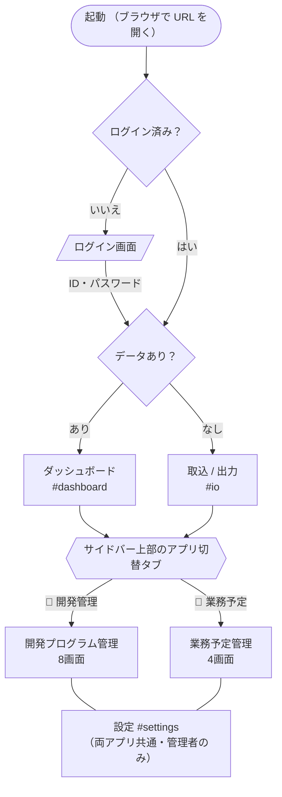

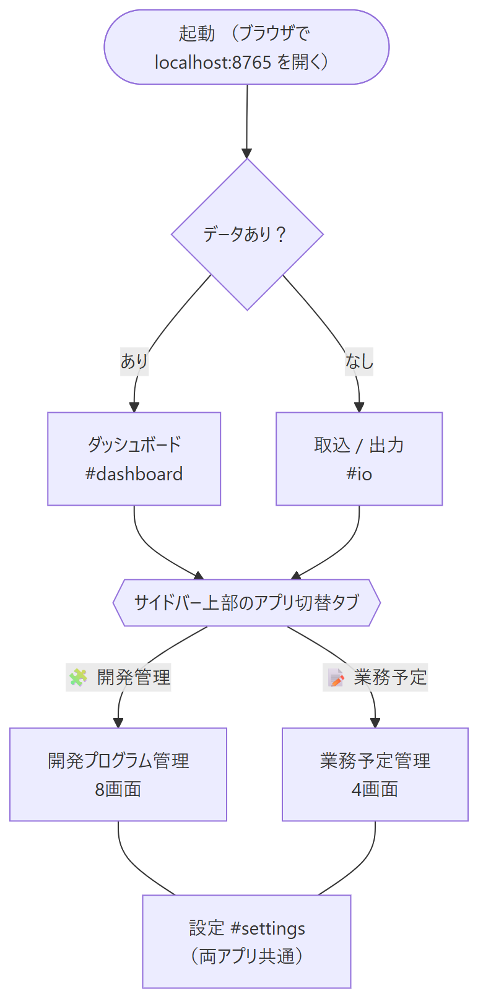

- アプリを切り替えると、そのアプリの先頭画面（`dashboard` / `planAssign`）へ遷移する
- 他アプリの画面 ID を直接指定した場合（ハッシュ入力・画面内リンク）は、アプリも自動的に切り替わる
- `settings` は例外で、どちらのアプリからでもアプリを切り替えずに表示される
- `settings` は管理者のみ表示される。一般ユーザーにはナビ項目が出ず（業務予定管理の「管理」グループごと非表示）、
  ハッシュで直接指定しても「この画面は管理者のみ利用できます」と通知して遷移しない

---

## 4. 開発プログラム管理 の画面遷移

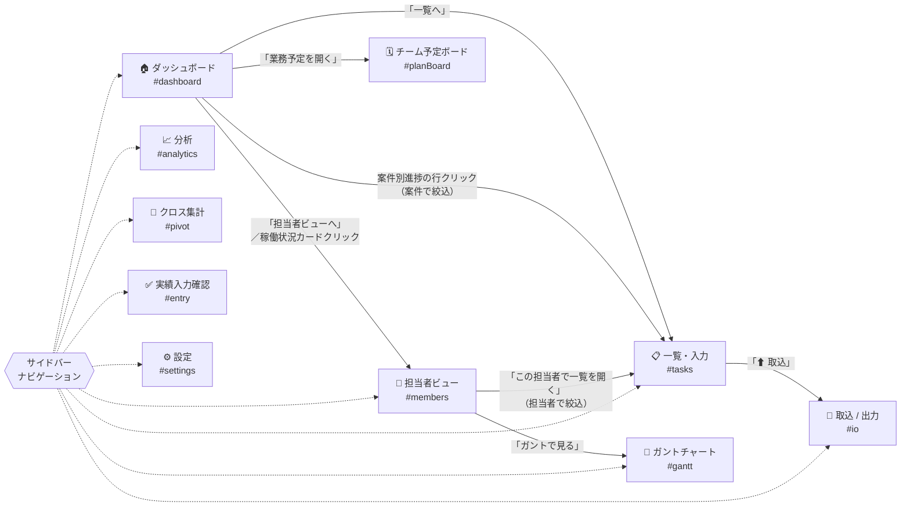

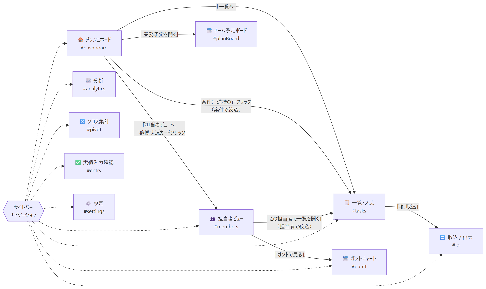

> サイドバーからは同アプリの全 9 項目（設定を含む）へ常に直接遷移できるため、上図では代表的な画面内リンクのみを実線で示している。

### 4.1 各画面から開くオーバーレイ

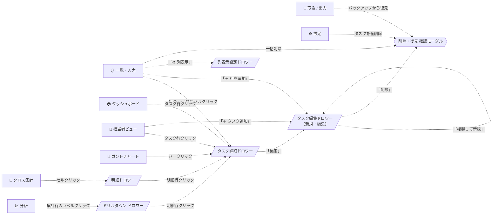

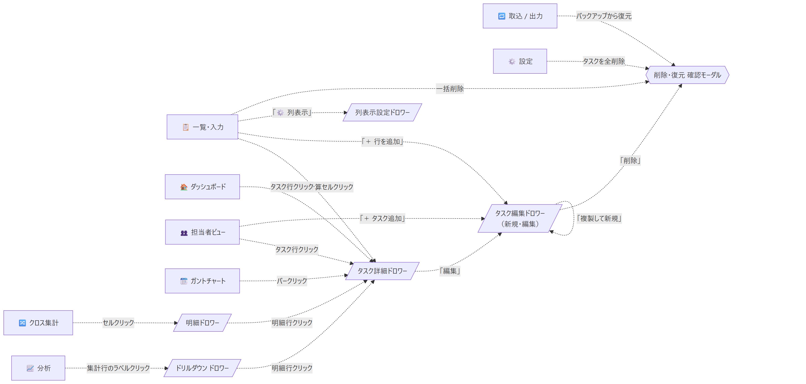

---

## 5. 業務予定管理 の画面遷移

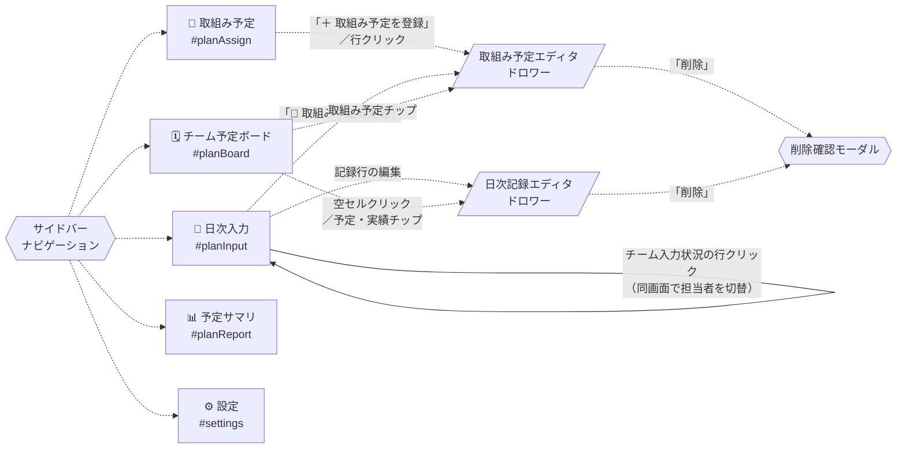

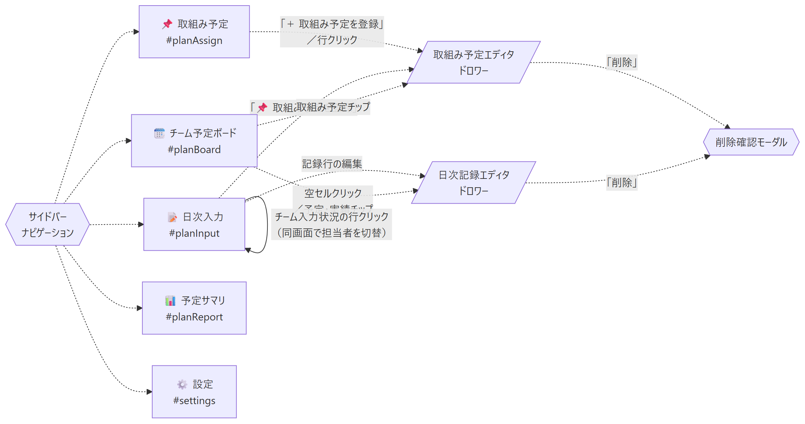

### 5.1 日次入力の画面内フロー

`planInput` は 1 作業＝1 行の予実一体シートで、同じ行の左に予定、右に実績を入力する。
「始業前」「終業前」は同じシートの左右の列で扱い、画面遷移は発生しない。

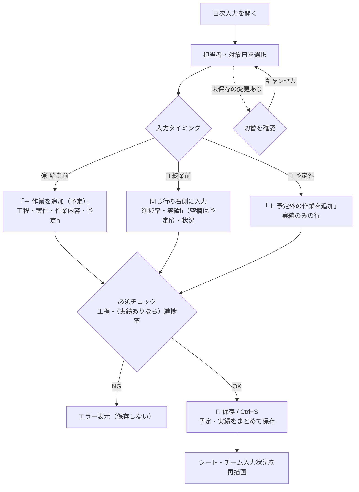

> 図版（PNG）は旧レイアウト時点のもの。最新は上記 mermaid を参照。

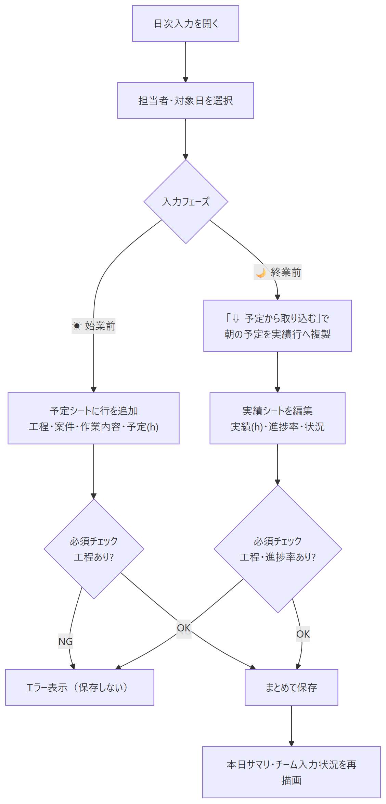

---

## 6. 共通 UI からの遷移

画面を問わず、上部バーとキーボードから利用できる遷移。

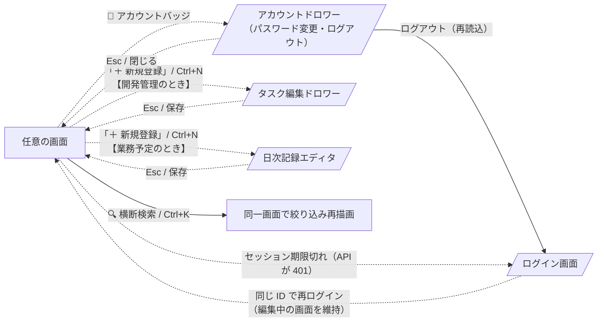

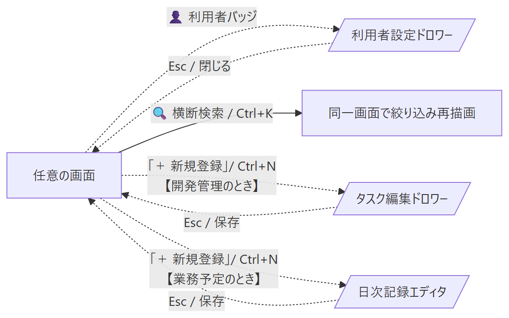

| 操作 | 効果 |
| --- | --- |
| `Ctrl + K` | 横断検索へフォーカス。入力すると現在の画面が絞り込まれて再描画される |
| `Ctrl + N` | 表示中のアプリに応じた新規登録ドロワーを開く |
| `Esc` | ドロワー／モーダルを閉じる |
| ブラウザの戻る／進む | URL ハッシュの変更を検知して該当画面へ遷移 |

---

## 7. 起動時フロー

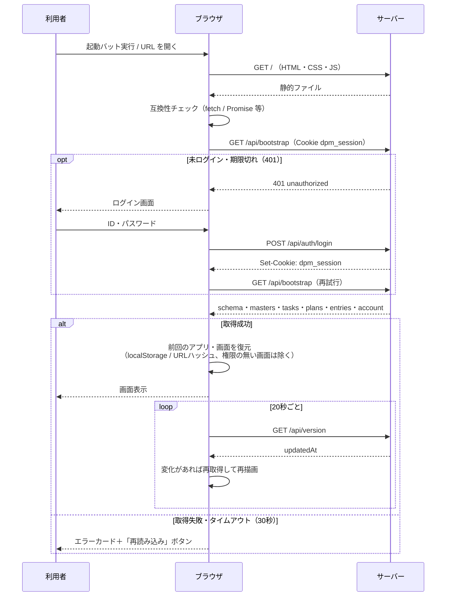

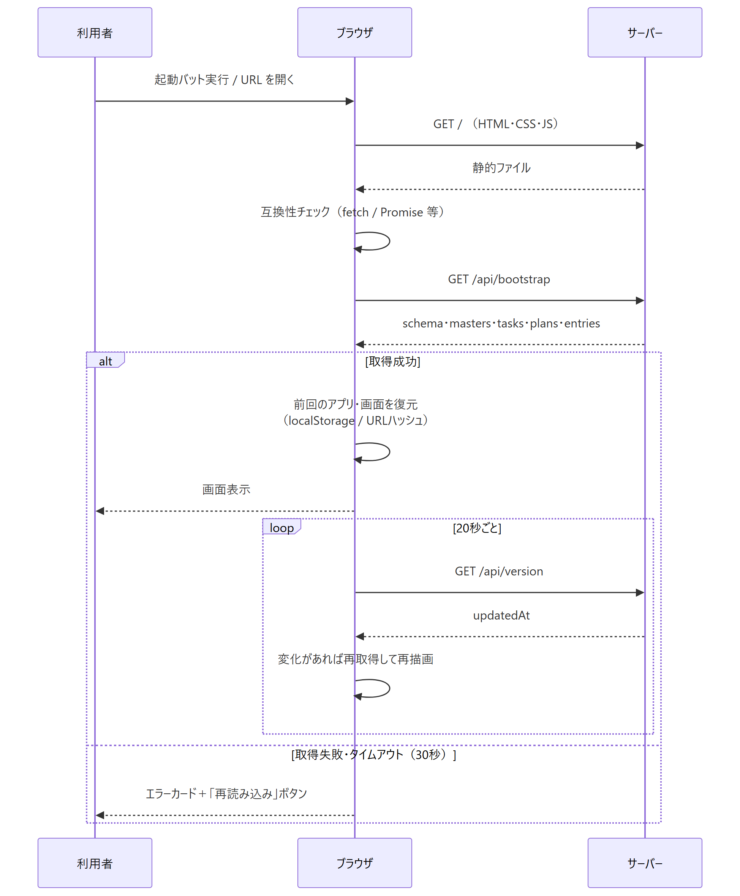

- データが 1 件も無い場合は、起動直後に `io`（取込 / 出力）へ自動遷移する
- ドロワー表示中・ログイン画面表示中は自動同期による再描画を抑止する（入力内容の消失防止）
- 別の ID でログインし直した場合は、画面と権限を切り替えるためページを再読込する

---

## 8. 遷移一覧表

### 8.1 画面 → 画面

| 遷移元 | 契機 | 遷移先 | 引き継ぐ条件 |
| --- | --- | --- | --- |
| （起動） | データ 0 件 | `io` | — |
| `dashboard` | 「一覧へ」 | `tasks` | — |
| `dashboard` | 案件別進捗の行クリック | `tasks` | 案件名で絞込 |
| `dashboard` | 「担当者ビューへ」 | `members` | — |
| `dashboard` | 稼働状況カードクリック | `members` | 担当者を選択状態に |
| `dashboard` | 「業務予定を開く」 | `planBoard` | アプリも切替 |
| `tasks` | 「⬆ 取込」 | `io` | — |
| `members` | 「この担当者で一覧を開く」 | `tasks` | 担当者で絞込 |
| `members` | 「ガントで見る」 | `gantt` | — |
| 全画面 | サイドバーのナビ項目 | 任意の画面 | — |
| 全画面 | アプリ切替タブ | 各アプリの先頭画面 | — |
| 全画面 | ブラウザ戻る／進む | ハッシュに対応する画面 | — |

### 8.2 画面 → オーバーレイ

| 遷移元 | 契機 | 開くもの |
| --- | --- | --- |
| `dashboard` / `members` / `gantt` | タスク行・バーのクリック | タスク詳細ドロワー |
| `tasks` | 行の ⋯／計算項目セルのクリック | タスク詳細ドロワー |
| `tasks` | 「＋ 行を追加」 | タスク編集ドロワー |
| `tasks` | 「⚙ 列表示」 | 列表示設定ドロワー |
| `tasks` | 選択行の一括削除 | 確認モーダル |
| `members` | 「＋ タスク追加」 | タスク編集ドロワー（担当者を初期設定） |
| `members` | 当日の予定チップ | 日次記録エディタ |
| `analytics` | 集計表のラベルクリック | ドリルダウンドロワー |
| `pivot` | 集計セルクリック | 明細ドロワー |
| `io` | バックアップから復元 | 確認モーダル |
| `settings` | タスクを全削除 | 確認モーダル |
| `planAssign` | 「＋ 取組み予定を登録」／行クリック | 取組み予定エディタ |
| `planInput` | 「📌 取組み予定を登録」 | 取組み予定エディタ |
| `planInput` | 記録行の編集 | 日次記録エディタ |
| `planBoard` | 空セル・予定／実績チップのクリック | 日次記録エディタ |
| `planBoard` | 取組み予定チップのクリック | 取組み予定エディタ |
| `settings` | 「＋ ユーザー追加」／「編集」 | ユーザー編集ドロワー |
| `settings` | 「PW初期化」／ユーザーの「削除」 | 確認モーダル |
| 全画面 | 👤 アカウントバッジ | アカウントドロワー |
| 全画面 | API が 401（セッション期限切れ） | ログイン画面 |
| 全画面 | 「＋ 新規登録」 / `Ctrl+N` | タスク編集 または 日次記録エディタ |

### 8.3 オーバーレイ内の遷移

| 遷移元 | 契機 | 遷移先 |
| --- | --- | --- |
| タスク詳細ドロワー | 「編集」 | タスク編集ドロワー |
| タスク編集ドロワー | 「複製して新規」 | タスク編集ドロワー（新規・値を複製） |
| タスク編集ドロワー | 「削除」 | 確認モーダル |
| ドリルダウン／明細ドロワー | 明細行クリック | タスク詳細ドロワー |
| 取組み予定エディタ | 種別が「取組み予定」 | 取組み予定エディタへ委譲 |
| 各エディタ | 保存／キャンセル／Esc | 呼び出し元の画面へ戻り再描画 |

---

## 9. 画面遷移に関する補足仕様

| 項目 | 内容 |
| --- | --- |
| 画面の記憶 | 選択中のアプリは `localStorage`（`dpm.app`）、画面は URL ハッシュに保持する |
| 絞り込み条件の保持 | `tasks` のフィルタ・表示列は `localStorage`（`dpm.tasks`）に保存し、再訪時に復元する |
| 画面内状態 | ガントの期間、分析の軸・指標、予定ボードの表示日数などはセッション中のみ保持（再読込で初期値に戻る） |
| 遷移時の引き継ぎ | `App.go(画面ID, パラメータ)` の第 2 引数で担当者・案件などの絞り込み条件を渡す |
| エラー時 | 描画中に例外が発生しても画面全体は落とさず、当該ビュー領域にエラーメッセージを表示する |
| 排他 | 画面遷移による排他制御は行わない。他利用者の更新は 20 秒ごとのポーリングで反映される |
| 権限 | 画面定義の `adminOnly` が真の画面（`settings`）は管理者以外に表示しない。サーバー側でも該当 API を 403 で拒否する |
| ログイン ID の記憶 | 最後にログインした ID を `localStorage`（`dpm.loginId`）に保存し、ログイン画面に補完する |

---

## 付録: 変更履歴

| 版 | 日付 | 内容 |
| --- | --- | --- |
| 1.0 | 2026-09-09 | 初版作成（全 13 画面・2 アプリ構成） |
| 1.1 | 2026-10-21 | ログイン画面・アカウントドロワー・ユーザー管理を追加。設定画面を管理者のみに変更 |
